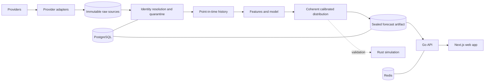

<div align="center">

# MatchForge

**A provider-neutral football forecasting and simulation platform that produces reproducible, point-in-time-safe probability distributions.**

[](https://github.com/sir-radar/match-forge/actions/workflows/ci.yml)


[Quick start](#quick-start) · [Architecture](#architecture) · [Repository layout](#repository-layout) · [Commands](#command-reference) · [Documentation](#documentation) · [Contributing](#contributing)

</div>

---

## Table of contents

- [Overview](#overview)
- [Project status](#project-status)
- [Features](#features)
- [Design principles](#design-principles)
- [Architecture](#architecture)
- [Tech stack](#tech-stack)
- [Repository layout](#repository-layout)
- [Quick start](#quick-start)
- [Configuration](#configuration)
- [Command reference](#command-reference)
- [HTTP API](#http-api)
- [Web app](#web-app)
- [Testing and quality gates](#testing-and-quality-gates)
- [Data, providers and responsible use](#data-providers-and-responsible-use)
- [Documentation](#documentation)
- [Contributing](#contributing)
- [License and use](#license-and-use)

## Overview

MatchForge ingests football data from several providers, preserves every source byte, resolves teams and fixtures to stable MatchForge identities, rebuilds what was known before each kickoff, and publishes calibrated match forecasts through a Go API and a Next.js web app.

The goal is not maximum complexity or the best score on one test set. It is forecasts that are reproducible, explainable, calibrated and honest about what the data supported at the time. Every material change is judged on chronological, leakage-safe evaluation against simple baselines, and development is gated by recorded owner decisions rather than by roadmap text.

## Project status

| Area | State |
| --- | --- |
| MVP product | Implemented. Live settlement evidence is still pending. |
| Forecast model | The retained rolling-goals Poisson champion (`transferable-rolling-goals-poisson-v1`, see [`config/models/current-champion.json`](config/models/current-champion.json)). H2H is display-only with zero model weight. |
| Model research | Paused for the MVP. Earlier challenger routes are closed or rejected. No promotion has occurred. |
| Rust simulation | Used as frozen, protocol-scoped evaluation evidence only. Production simulation validation is not authorized. |
| Architecture V2, identity resolution | In progress. No production cutover recorded. |

Current facts live in [`docs/project-status.json`](docs/project-status.json) (checked by `make project-status-check`) and are summarized in [`docs/status/current-state.md`](docs/status/current-state.md). If this README and the status file disagree, the status file is right.

## Features

- **Provider-neutral ingestion.** Adapters for football-data.org, football-data.co.uk, openfootball, API-Football, FotMob and PitchAPI, Sportmonks for benchmark comparisons, plus StatsBomb qualification work. Provider IDs and names are source evidence, never MatchForge identity.
- **Immutable raw sources.** Provider bytes are written once and referenced by checksummed manifests, so any forecast can be traced back to its source.
- **Explicit identity resolution.** Teams, competitions and fixtures are matched deterministically with quarantine, review and correction workflows. Names are never merged by similarity alone.
- **Point-in-time history.** Separate `football_cutoff`, `knowledge_cutoff` and `knowledge_mode` rules keep post-kickoff information out of forecasts. Equal-kickoff fixtures are batched so none can see another's result.
- **Coherent probabilities.** Result, score, goals, BTTS and clean-sheet probabilities come from one joint score distribution. Invalid distributions are rejected, not renormalized.
- **Immutable artifacts and forecasts.** Fitted model artifacts and published forecasts are never edited. Corrections create new versions and earlier forecasts stay retrievable.
- **Chronological evaluation.** Walk-forward backtests, paired bootstrap uncertainty and out-of-sample calibration, with frozen protocols and protected target sets.
- **Rust score simulation.** A deterministic, seeded sampler used to check analytic parity and Monte Carlo convergence.
- **Admin tooling.** Sync runs, shared work queue, market readiness and an identity resolution center.
- **External prediction comparison.** Collects public third-party predictions for private, local comparison only.

## Design principles

1. Raw source is immutable, and lineage reaches it.
2. Identity is provider-neutral and explicit.
3. Historical forecasts are point-in-time safe, and target outcomes stay sealed until prediction.
4. Models do not choose their own historical universe. A central provider supplies eligible history.
5. Related probabilities come from one coherent distribution.
6. Artifacts and forecasts are immutable, and raw probabilities are never overwritten.
7. Evaluation is chronological. Simple baselines stay the benchmark, and complexity must earn its place.
8. Phase gates are real gates. Research acceptance, promotion and production enablement are separate approvals.

The full rule set is in [AGENTS.md](AGENTS.md) and [docs/architecture.md](docs/architecture.md).

## Architecture

Each language owns one concern.

| Language | Owns |
| --- | --- |
| Python | Provider adapters, ingestion, normalization, identity, point-in-time reconstruction, features, model fitting, forecasting, calibration, evaluation, reports |
| Rust | Pure deterministic simulation and Monte Carlo sampling |
| Go | HTTP serving, request validation, admin access, health and readiness, retrieval of generated forecasts and reports |
| SQL | The only schema authority (goose migrations) |
| JSON Schema | Cross-language contracts |
| TypeScript | The Next.js web app |



Storage ownership: raw provider bytes live in immutable files, structured state in PostgreSQL, high-volume analytical data in Parquet, model artifacts in immutable files, and Redis holds cache and ephemeral job state only.

See [docs/architecture.md](docs/architecture.md), [module boundaries](docs/architecture/module-boundaries.md) and [artifact boundaries](docs/architecture/artifact-boundaries.md).

## Tech stack

| Layer | Technology |
| --- | --- |
| Python | 3.13.14, managed by [uv](https://docs.astral.sh/uv/); Polars, PyArrow, Pandera, SciPy, psycopg 3, jsonschema, penaltyblog; Ruff, MyPy, pytest, Hypothesis |
| Rust | 1.97.1, edition 2024, one workspace crate (`rust/simulation-core`) |
| Go | 1.27.3, standard library HTTP server, pgx v5; golangci-lint |
| Web | Next.js 16, React 19, TypeScript 5.9, Tailwind CSS 4, shadcn/ui, Vitest, Playwright; pnpm 10 |
| Data | PostgreSQL 18, Redis 8, goose migrations |
| Tooling | Make, Docker Compose, GitHub Actions |

Versions are pinned in `.python-version`, `rust-toolchain.toml`, `go/api/go.mod`, `uv.lock`, `web/pnpm-lock.yaml` and `compose.yaml`. Local development targets macOS on Apple Silicon.

## Repository layout

```text
.
├── python/football/          Python package: data, identity, features, models, reports, CLI
│   ├── src/football/
│   │   ├── providers/        Provider adapters
│   │   ├── ingestion/        Acquisition and canonical ingestion
│   │   ├── normalization/    Provider-neutral normalized data
│   │   ├── identity/         Identity resolution
│   │   ├── temporal/         Point-in-time rules
│   │   ├── forecasting/      Models, calibration, forecasts
│   │   ├── history/          Historical datasets and backfill
│   │   ├── work/             Shared work orchestration
│   │   ├── reports/          Immutable analytical reports
│   │   ├── product/          MVP sync, resolution center, public reports
│   │   ├── storage/ · validation/ · observability/ · cli/ · …
│   └── tests/                Package tests
├── rust/simulation-core/     Deterministic score sampler and validation artifacts
├── go/api/                   HTTP API (cmd/api entrypoint, internal/app handlers and stores)
├── web/                      Next.js app (app/, components/, lib/, e2e/, ui-designs/)
├── infrastructure/
│   ├── migrations/           goose SQL migrations (schema authority)
│   └── systemd/              Scheduled refresh timer and service units
├── schemas/                  JSON Schema contracts, Arrow schemas, quality policies
├── config/models/            Registered model configuration (current champion)
├── docs/                     Architecture, contracts, governance, evidence, reports (start at docs/README.md)
├── scripts/                  Bootstrap, doctor, dev watcher, integration and research runners
├── tests/                    Repository-level and integration tests
├── experiments/              Disposable Gate A prototype
├── data/fixtures/            Small test fixtures
├── compose.yaml              Local PostgreSQL and Redis
├── Makefile                  Single entry point for every workflow
├── PLAN.md                   Roadmap, invariants and release gates
├── AGENTS.md · CLAUDE.md     Engineering rules for contributors and coding agents
└── .github/workflows/ci.yml  Pull-request and main-branch checks
```

Generated and local-only paths (`.local/`, `.tools/`, `.venv/`, `target/`, `dist/`, `.env`) are git-ignored.

## Quick start

### Prerequisites

- macOS on Apple Silicon (arm64). `make bootstrap` refuses other hosts.
- Git and Docker with Compose (PostgreSQL and Redis run in containers).
- Node.js and pnpm 10 for the web app. `make bootstrap` installs the rest (uv, Python, Rust, Go, goose, golangci-lint) into `.tools/`.

### Set up

```bash
git clone https://github.com/sir-radar/match-forge.git
cd match-forge
cp .env.example .env
```

Fill in the required values in `.env` (see [Configuration](#configuration)), then:

```bash
make bootstrap
make doctor
```

### Run the app

```bash
make migrate
make dev
```

`make migrate` starts PostgreSQL and Redis and applies migrations. `make dev` runs the Go API with automatic restart and the Next.js dev server.

- Web app: <http://127.0.0.1:3000>
- API: <http://127.0.0.1:8080>

### Load data

```bash
make mvp-sync DATE=2026-11-10
make mvp-sync FROM_DATE=2026-11-01 DATE=2026-11-10
make external-predictions DATE=2026-11-10
```

Provider sync needs the credentials for the providers you enable. See [CLI usage](docs/cli.md) for the data-pipeline commands.

## Configuration

Copy `.env.example` to `.env`. It is git-ignored; never commit real values. The main groups:

| Group | Variables | Notes |
| --- | --- | --- |
| Local services | `POSTGRES_DB`, `POSTGRES_USER`, `POSTGRES_PASSWORD`, `POSTGRES_PORT`, `REDIS_PORT` | Required by `compose.yaml`. Ports bind to `127.0.0.1`. |
| Connections | `DATABASE_URL`, `POSTGRES_ADDR`, `REDIS_ADDR` | Required by migrations, API and sync. |
| Serving | `API_ADDR`, `WEB_ORIGIN`, `NEXT_PUBLIC_API_BASE_URL`, `NEXT_PUBLIC_TIME_ZONE`, `READ_TIMEOUT`, `HANDLER_TIMEOUT` | Defaults bind to loopback. |
| Provider credentials | `API_FOOTBALL_API_KEY`, `SPORTMONKS_API_TOKEN`, `FOOTBALL_DATA_DOT_ORG_API_TOKEN`, `PITCH_API_TOKEN` | Only for providers you enable. |
| Feature switches | `MATCHFORGE_FOTMOB_ENABLED`, `MATCHFORGE_PITCHAPI_ENABLED`, `MATCHFORGE_HISTORY_SYNC_ENABLED`, `MATCHFORGE_CONTEXT_SYNC_ENABLED`, `MATCHFORGE_MODEL_*_ENABLED`, … | Optional features default to off. Enabling one is not provider consent. |
| Request budgets | `MATCHFORGE_CONTEXT_REQUEST_CAP`, `MATCHFORGE_PROVIDER_*`, `MVP_HISTORY_SYNC_CONCURRENCY` | Bound provider calls. |
| Admin | `MATCHFORGE_ADMIN_CLI_TOKEN` | Loopback automation only. Never expose it in a `NEXT_PUBLIC_*` variable. |
| Storage paths | `FOOTBALL_DATA_ROOT`, `MATCHFORGE_MODEL_ARTIFACT_ROOT` | Default under `.local/`. |

## Command reference

Every workflow goes through `make`. Run `make -n <target>` to see what a target does before running it.

| Task | Command |
| --- | --- |
| Install toolchains and dependencies | `make bootstrap` |
| Check the local environment | `make doctor` |
| Start / stop PostgreSQL and Redis | `make up` / `make down` |
| Remove containers and volumes | `make clean` |
| Apply / inspect migrations | `make migrate` / `make migration-status` |
| Run API and web app with reload | `make dev` |
| Run only the Go API with reload | `make dev-go` |
| Format all languages | `make format` |
| Lint, type-check, vet | `make lint` |
| Unit tests (Python, Rust, Go) | `make test` |
| Python tests with branch coverage | `make test-coverage` |
| Build all artifacts | `make build` |
| Architecture boundary check | `make architecture-check` |
| Verify the tracked project status | `make project-status-check` |
| **Full pre-merge check** | `make check` |
| Docker-backed integration tests | `make integration` |
| Everything CI runs | `make check integration` |
| Web lint, tests, build, end-to-end | `make web-lint` · `make web-test` · `make web-build` · `make web-e2e` |
| Sync fixtures and results | `make mvp-sync DATE=YYYY-MM-DD` |
| Historical backfill, other providers | `make history-backfill` · `make all-data-sync` · `make fotmob-sync` · `make pitchapi-sync` · `make openfootball-sync` · `make football-data-uk-sync` |
| Refresh forecasts | `make forecast-refresh` |
| Collect external predictions | `make external-predictions DATE=YYYY-MM-DD` |
| Identity audit | `make identity-check` |
| Sprint 2 evaluation (clean worktree required) | `make sprint2-evaluate` |
| Gate A prototype | `make prototype-gate-a` |

Research and evaluation runners (`scripts/run_*.py`, `make v2-final-*`, `make full-coverage-v2-*`) execute frozen protocols. Do not run them unless the current owner decision authorizes it; see [docs/status/current-state.md](docs/status/current-state.md).

## HTTP API

The Go service serves versioned JSON under `/v1` and keeps liveness independent of dependencies.

| Endpoint | Purpose |
| --- | --- |
| `GET /healthz`, `GET /readyz`, `GET /version` | Liveness, readiness (PostgreSQL, schema version, Redis), build identity |
| `GET /v1/competitions`, `GET /v1/fixtures` | Competitions and fixture listings |
| `GET /v1/fixtures/{id}/forecasts[/{forecast_id}]` | Forecast history and a single forecast |
| `GET /v1/fixtures/{id}/live`, `…/context` | Live state and match context |
| `GET /v1/competitions/{id}/standings`, `…/performance`, `GET /v1/performance` | Standings and forecast performance |
| `GET /v1/external-predictions`, `…/external-prediction-sources` | External prediction comparison |
| `/v1/admin/*` | Protected sync runs, work queue, market capabilities, identity resolution |

[`docs/api/openapi.yaml`](docs/api/openapi.yaml) is the contract. [Compatibility policy](docs/api/compatibility-policy.md) governs changes: additive first, explicit versioning for breaking ones.

## Web app

Next.js server components fetch from the Go API.

| Route | Content |
| --- | --- |
| `/` | Fixture explorer with filters and inline expandable fixture detail |
| `/predictions` | Prediction and external-prediction comparison |
| `/performance` | Forecast performance |
| `/admin/data-sync`, `/admin/resolution` | Operator pages |

UI work follows [docs/frontend-engineering.md](docs/frontend-engineering.md). The HTML files in [`web/ui-designs/`](web/ui-designs/) are the authoritative design references.

## Testing and quality gates

`make check` runs formatting, Ruff, MyPy, Clippy, `go vet`, golangci-lint, migration validation, unit tests, the architecture boundary check, build, project-status validation, and web lint, tests and build. `make integration` adds the Docker-backed storage and API suites. CI runs both on every pull request and on `main` ([docs/ci.md](docs/ci.md)).

The project also enforces:

- leakage and same-kickoff tests on anything touching history or evaluation;
- reproducibility checks on artifacts, with logical-state checksums;
- cyclomatic complexity limits on new or changed code;
- an automatic architecture boundary check (`make architecture-check`) that stops layers importing across ownership lines.

Never weaken or skip a gate to make a change pass. See [docs/testing.md](docs/testing.md) and the [test matrix](docs/engineering/test-matrix.md).

## Data, providers and responsible use

MatchForge is a private, local, non-commercial research project. Provider data is retained for private analysis and must not be published or redistributed. Provider terms, credentials, quotas and entitlements are recorded separately from the project's own authorization and must still be respected. The standing acquisition policy is in [docs/source-acquisition.md](docs/source-acquisition.md).

Scheduled refresh runs through `infrastructure/systemd/matchforge-mvp-refresh.timer` (06:00 `Africa/Lagos`) and `scripts/mvp-refresh.sh`. Adjust the user and `/opt/matchforge` path when installing.

## Documentation

The [documentation index](docs/README.md) maps every document. Good starting points:

| If you want to… | Read |
| --- | --- |
| See what is true today | [docs/status/current-state.md](docs/status/current-state.md), [docs/project-status.json](docs/project-status.json) |
| Understand the roadmap and gates | [PLAN.md](PLAN.md) |
| Learn the system boundaries | [docs/architecture.md](docs/architecture.md) |
| Understand data and time rules | [docs/data-model.md](docs/data-model.md), [docs/temporal-model.md](docs/temporal-model.md), [docs/backtesting.md](docs/backtesting.md) |
| See model and promotion rules | [docs/model-governance.md](docs/model-governance.md), [docs/evaluation/promotion-gates.md](docs/evaluation/promotion-gates.md) |
| Work on the backend / frontend | [docs/backend-engineering.md](docs/backend-engineering.md), [docs/frontend-engineering.md](docs/frontend-engineering.md) |
| Run data pipelines | [docs/cli.md](docs/cli.md), [docs/canonical-ingestion.md](docs/canonical-ingestion.md) |
| Handle backup and recovery | [docs/recovery.md](docs/recovery.md) |

## Contributing

Read [AGENTS.md](AGENTS.md) first; [CLAUDE.md](CLAUDE.md) adds the document-consistency rules.

- **Phase-gated work.** Check the current phase and authorization in [docs/project-status.json](docs/project-status.json) before starting. A roadmap sequences work; only a recorded owner decision authorizes it.
- **Branches.** Branch from `main` for each task (for example `docs/<topic>` or `ft/<topic>`). One concern per branch.
- **Commits.** Small, one logical stage each, with a message that explains why. Never use `--no-verify`.
- **Before a pull request.** Run `make check integration` when any code, schema or status file changed. For prose-only changes, run `git diff --check` and verify links. See [docs/git-delivery.md](docs/git-delivery.md).
- **Pull requests.** Use the [PR template](docs/pr-template.md) and the [review checklist](docs/review-checklist.md).
- **Immutable history.** Do not edit `docs/evidence/`, decision events or dated reports to match later facts. Add a new record.
- **Secrets.** Never commit `.env`, tokens or provider payloads.

## License and use

This is a private research repository. It carries no open-source license, and no right to use, copy, distribute or publish the code or any provider data is granted. Contact the repository owner for permission.
