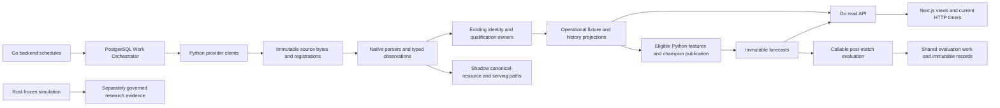

# Current architecture and operating evidence

Investigation checkpoint I0, 10 November 2026. Repository baseline:
`0b83991856e9f7d6528beb2477d83a0ac27ea4fb`. This is an investigation, not
implementation or rollout evidence for the proposed redesign.

## Authority and scope

`CURRENT_TASK.md` revision 3 authorizes inspection, research, disposable technical
experiments and planning. It prohibits operating changes, broad acquisition,
scientific fitting/evaluation, promotion, deployment and V2 cutover. Its narrower
scope applies even though `docs/source-acquisition.md` records broader standing
research acquisition authority. No terminal scientific route is reopened.

The owner supplied
[the companion product plan](../../../MatchForge_Post_Redesign_Extensible_Football_Product_Implementation_Plan_v2_2026-11-09.md)
during investigation. It is preserved unchanged as an input. Its F0–F11 tickets
are proposals, not this task's implementation backlog. A01 / the percentage
Probability Filter is excluded. The separate original 40-item audit was not
supplied; the named 15 foundation requirements and the companion's gap references
are available. Exact missing audit wording must not be reconstructed as fact.

Only root `AGENTS.md` was found. No current Wayfinder map or ticket was identified
in the checkout or available tool inventory. Historical Wayfinder routes remain
evidence only. `PLAN.md` is a historical proposed roadmap; its acquisition-policy
notice points to the newer standing decision. Current phase/gate truth stays in
`docs/project-status.json`, contracts and dated evidence, not an inferred phase
number from this investigation.

GitHub read-only inspection confirmed:

| PR | Current state | Relevant consequence |
| --- | --- | --- |
| [#179](https://github.com/sir-radar/match-forge/pull/179) | Merged, merge `5ab0569` | Readiness, rolling-source identity and recovery fixes already in baseline |
| [#178](https://github.com/sir-radar/match-forge/pull/178) | Merged into integration, `fbcf0e3` | V4/provider/identity work retained; proof blockers unchanged |
| [#182](https://github.com/sir-radar/match-forge/pull/182) | Merged into main, `0b83991` | Combined behavior plus forward migration `202611100200`; no operating rollout implied |

Do not redo these merges. The integration report
[`v4-post-remediation-integration.md`](../../evidence/v4-post-remediation-integration.md)
records an aggregate exit 2 followed by passing corrected migration tests and
remaining integration checks. That is not a successful aggregate exit.

## Method and limits

Operating PostgreSQL connections set `default_transaction_read_only=on`,
20-second statement and one-second lock timeouts, and use
`REPEATABLE READ READ ONLY`, savepoints for independent diagnostics, and final
`ROLLBACK`. No provider endpoint, admission, sync-start, fit, promotion or migration
command was invoked. Normal pre-existing backend jobs continued independently.
HTTP observations occur after database snapshots and are separately timed.

| Receipt, under ignored `.local/unified-architecture-investigation/` | SHA-256 |
| --- | --- |
| `baseline.json` | `f930814c1a4bd9abcde178fc999a7654d66825101cd4837660943f103b50cafe` |
| `followup.json` | `539ff39490a3ab09feec0e7589aac3d62574cecd9cc8c7c7938b4cc3dded5378` |
| `final-reads.json` | `6ec88a068c65db97140a002b67b65e0975d75fdff214b38d8a3b6f9c448d29b7` |
| `corrections.json` | `42ae18383b95ef6970700a2a75e7ca4f6cb9e79567dea5b8114e67da8c55cd6f` |
| `compression.json` | `be7913d906a30981bb850dea8ad23dc0b82913b81f792a66bb093b1397c112a4` |

Receipts contain executed SQL and aggregates/bounded records; credentials and
source payloads are not committed. Snapshot identifiers cannot be reused after
rollback. These receipts are local reproducibility aids, not public datasets.
The final verification memo records further measurements separately.

Two initial diagnostics used nonexistent `issued_at` and
`relative_path`/`byte_size`; corrected queries use `created_at` where needed and
`provider_path`/`size_bytes`. An example season query used nonexistent `s.name`;
the corrected query retains the actual season record. A whole shadow-serving
view duplicate census exceeded 20 seconds and was cancelled. Successful queries
were retained; none of those failures is reported as a passing measurement.

## Operating snapshot

B0 cutoff: **2026-11-10 06:09:24.281256 UTC** (07:09 Africa/Lagos), database
`football`, PostgreSQL **18.6**, snapshot `22342084:22342084:`.

| Measurement | Observed result | Interpretation |
| --- | --- | --- |
| Applied Goose records | 115, latest `202611100100` | Full version list retained; `202611100200` absent |
| `/version` | `dev`, commit/lock/worktree all `unknown` | Running release identity **UNVERIFIED**, despite healthy service |
| `/healthz`, `/readyz` | HTTP 200, `ok` / `ready` | Dependency readiness, not deployed-commit or scientific acceptance |
| Stage settings, follow-up | All 13 `LEGACY`, generation 0 | V2 cutover has not occurred |
| Provider work | Two `PROVIDER_ACQUISITION` RUNNING with unexpired leases | Backend acquisition operating; no browser initiated it during audit |
| Historical work | Four RUNNING, zero unexpired leases | Stored RUNNING does not prove active execution |
| Post-match evaluations / runtime registrations | 0 / 0 | No operating evidence for continuous evaluation or registered routing |
| Shared observation / capability registries | 12,310 / 26 | Retained rows do not establish V2 serving adoption |
| Dedicated context tables | Availability/lineups/coaches/accuracy all 0 | Separately retained provider LINEUPS resources are not qualified context |
| Forecasts, later snapshot | 18,162, all bound to existing champion hash | 530 original algorithm; 17,632 `rolling10-v2`; no new champion |
| Scheduled future fixtures | 2,267 verified available; 133 verified history-short; 16 verified source-incomplete; 3,551 provisional source-incomplete | 5,967 records; cohorts overlap older FR tickets and are time-sensitive |
| Stored FINISHED | 269,132; none missing either score | No universal missing-finished-score defect observed |
| Stored LIVE | 79; 45 missing scores | Lifecycle/recovery investigation required, not zero-score substitution |

At 06:14 UTC, 74 of 79 LIVE rows had kickoffs more than one day earlier;
earliest kickoff was 12 October. All 45 missing-score rows had no bound provider
resource observation. Their native-mapping trace found API-Football mappings but
no matching operational FotMob/PitchAPI fixture observation. This identifies a
break before resource-backed serving; it does not prove whether an upstream
API-Football result exists, whether acquisition was denied, or whether another
native fixture is the same match. Investigate those exact IDs through the
existing recovery owners; never infer FT from elapsed time.

The running sync API reports FotMob and PitchAPI enabled, a 30-second operational
schedule, history schedule disabled and a one-hour configured history interval.
A single status request took 7.310 seconds / 69,538 bytes. Today's fixture snapshot
took 0.249 seconds / 108,755 bytes, 114 fixtures: 2 `FRESH`, 112 `UNKNOWN`, none
`STALE`. This mixed lifecycle population is not a live-score freshness SLO.
External Predictions returned 13 records, page size 20: pagination is still
implemented. Single requests are measurements, not percentile budgets.

## Data-correctness cohorts

| Cohort | Evidence and first established cause | Safe recovery and remaining proof |
| --- | --- | --- |
| Same-key fixture candidates | 281 groups / 567 rows share competition, ordered teams and kickoff; season deliberately not assumed equal | Review native relationships and season scope; not 281 proven duplicates or forecast gains |
| Exact Premier League example | `5a87caaf-ad90-5c91-bb6e-17fa02f2640b` (FDO `560584`), `5bbb0ec6-60f6-5e35-a025-59378dd54d7e` (CSV `mmz4281/2627/data.zip!E0.csv#45`), `c9eeba85-75b0-5566-aff8-7f0ad50d9253` (OpenFootball `2026-27/en.1.json#43`) | Same 1–0 result and participants/kickoff, three distinct season UUIDs; existing reconciliation requires identical season. Establish exact season equivalence before reuse/relationship correction |
| Example public output | Shadow `product_serving_fixtures` contains none of the three; one dated API request returned none of their IDs among 249 fixtures | Does not establish duplicate public cards or a canonical merge; runtime/representative selection requires further bounded trace |
| Unbound latest finished observations | FotMob 10,873; PitchAPI 2,097, with both scores | Potential retained evidence; native identity, season, score basis and chronology still qualify independently |
| Historical ingestion conflicts | CSV: 1,491 provider-ID-reuse, 282 team/timestamp, 35 unreviewed cross-provider records | Historical retained counts, not proof that merged rolling-ID fixes regressed; review latest affected source revision and current consumer |
| Missing originals/manifests | FR-011 and integration report retain specific gaps | Search checksum-exact backups; new corroborated facts cannot repair a missing original hash |
| V2 parity | Five SUCCEEDED work items contain BLOCKED reports; two PENDING | Execution success and acceptance failure are distinct; complete full required scopes before Phase 35 |
| StatsBomb legacy identities | Prior IDR report: 21 source-verified mappings, no independent relationships established | No proof-free admission or automatic reopening of that route |

For MC Oran–Olympique Akbou fixture
`dffecb0c-fdff-5811-a276-5ddebc9a71c2`, the fresh row is `FINISHED`, verified,
0–0, `REGULATION_90`, updated 31 October, with API-Football native `1611440`.
The older remediation report's SCHEDULED assertion is a **historical difference**.
There is no directly bound operational native observation for this fixture.
The separate FotMob `5989865`/`264ccd72-e939-520b-b7b1-0f049ecea19d` relationship
must be rechecked before declaring the original contradiction resolved.
Current canonical completeness is not proof that both sources agree.

## Current owner and consumer inventory

Paths below are repository-relative. Maturity is scoped: implemented means code
was inspected, not that every existing test was rerun or deployment verified.

| Domain / implementation owner | Schema or contract / consumer / existing verification | Maturity and reuse |
| --- | --- | --- |
| `providers/sources/contracts.py`, provider-specific clients, `providers/native/` | `ProviderPayload`, native parsers; `providers/normalization/pipeline.py`; `tests/integration/test_provider_resource_capabilities.py` | Acquisition is OPERATING_VERIFIED for enabled operational lanes; V2 ports SHADOW_ONLY; preserve provider differences |
| `storage/raw.py`, `observations/storage.py` | Source snapshots/resources; `resource-observations-v1/v2/v3.schema.json`; normalized resources and canonical resolution; `test_resource_observation_artifacts.py` integration | Immutable storage implemented; shared observation serving SHADOW_ONLY; no duplicate raw store |
| `providers/capability_registry.py`, `providers/resource_authority.py` | `provider_resource_capabilities`, immutable scope transitions; resource planning/normalization; capability integration tests | SHADOW_ONLY; source access and canonical/consumer eligibility remain separate |
| `identity/repository.py`, `product/identity_admission.py`, `product/identity_correction.py`, `history/fixture_identity.py` | Canonical IDs, mappings/history, reviewed crosswalks, corrections, `RealFixtureIdentityV1`; history and serving; identity/correction integration tests | Existing operating owners reusable; some relationships BLOCKED; no name-based replacement |
| `canonical_resources/resolution.py`, `canonical_resources/storage.py` | Resolution policies, selected source claims and temporal decisions; shadow projections; `test_canonical_resource_resolutions.py` | SHADOW_ONLY; do not turn source authenticity into canonical admission |
| `product/operational_provider_sync.py`, `product/live_resources.py`, `product/fixture_reconciliation.py` | Native fixture/resources, refresh state, identity resolutions; Go fixture/live endpoints; operational/live-order tests | Operating observations verified; exact deployed code UNVERIFIED; extend recovery per scope |
| `work/contracts.py`, `work/storage.py`, SQL work adapters | Migration `202610180700`, `WorkRequest`, leases/generations; workers and Go schedules; work/fencing integration tests | OPERATING_VERIFIED for observed types; retired adapter cutover remains gated |
| `product/external_prediction_recovery.py` | Bindings and append-only settlement revisions; `external_prediction_store.go`; `test_external_prediction_recovery.py` | Implemented bounded SQL-only settlement; autonomous scope coverage UNVERIFIED; reuse instead of new settlement engine |
| `product/context_sync.py`, `context/live.py` | `LineupObservation`, `AvailabilityObservation`, `PredictedLineupV1`, live-context contract; context/UI; context tests | IMPLEMENTED_UNSCHEDULED for context feature paths; no qualified operating rows; no predictive champion effect |
| `forecasting/features.py`, `forecasting/dataset.py`, `forecasting/model_runner.py` | Point-in-time inputs, `ModelRegistration`, artifact/feature compatibility; forecast publication; model/backtesting tests | Champion forecasts OPERATING_VERIFIED by stored bindings; registry path IMPLEMENTED_UNSCHEDULED in operating DB |
| `forecasting/postmatch.py`, `postmatch_storage.py`, `postmatch_cli.py` | `post-match-evaluation.schema.json`, migration `202610190400`, `POST_MATCH_EVALUATION`; monitoring CLI; unit/integration `test_postmatch.py` | IMPLEMENTED_UNSCHEDULED; no scheduler found in `app.go`, no evaluation rows; not continuous learning |
| `forecasting/experiments.py`, `evaluation_protocol.py`, `replacement_holdout.py`, `governance.py` | Immutable experiment/holdout/promotion policies; governed research runners; protocol/firewall tests | Existing research owners, some closed/blocked routes; automatic challenger fitting DOCUMENTED_ONLY |
| `go/api/internal/app/` | `app.go` routes, `postgres_store.go`, OpenAPI, `web/lib/contracts.ts`; serving/database/contract tests | Existing HTTP owner; no SSE route in inspected router; build identity UNVERIFIED |
| `web/app/`, `web/components/`, `web/hooks/` | Next 16.4.1, React 19.2, Tailwind 4.1.14; fixture/research/Admin; component and Playwright tests | Client timers present; Admin server shells do not fetch initial authorized data; event replacement DOCUMENTED_ONLY |
| `scripts/capture_architecture_v2_baseline.py`, `football.integrity` | Exported snapshot + dump + source archive, `IntegrityVerificationReportV1`; recovery; baseline/restore integration tests | Capture and isolated DB restore implemented; complete automated cross-store DR UNVERIFIED |
| `rust/simulation-core` | Frozen V2/V3/V4 simulation, seed/float/hash/interval contracts; research executables and `src/tests.rs` | Research/frozen-validation owner; no operational Go/Python runtime call found; retain |

Python module paths in this table are beneath
`python/football/src/football/`; integration tests are beneath `tests/integration/`
unless stated otherwise. Precise future changes and proposed tests belong to the
single implementation roadmap, not this inventory.

## Actual dependency map

Read-only source inspection establishes the arrows, including imports in
`operational_provider_sync.py` to raw storage, identity admission, live ordering,
fixture reconciliation and existing settlement. It does not establish that every
shadow path is a runtime dependency. `scripts/check_architecture_boundaries.py`
guards direct imports, known fitting dependencies and registered worker paths;
that static check is narrower than a full transaction/SQL-writer proof.
