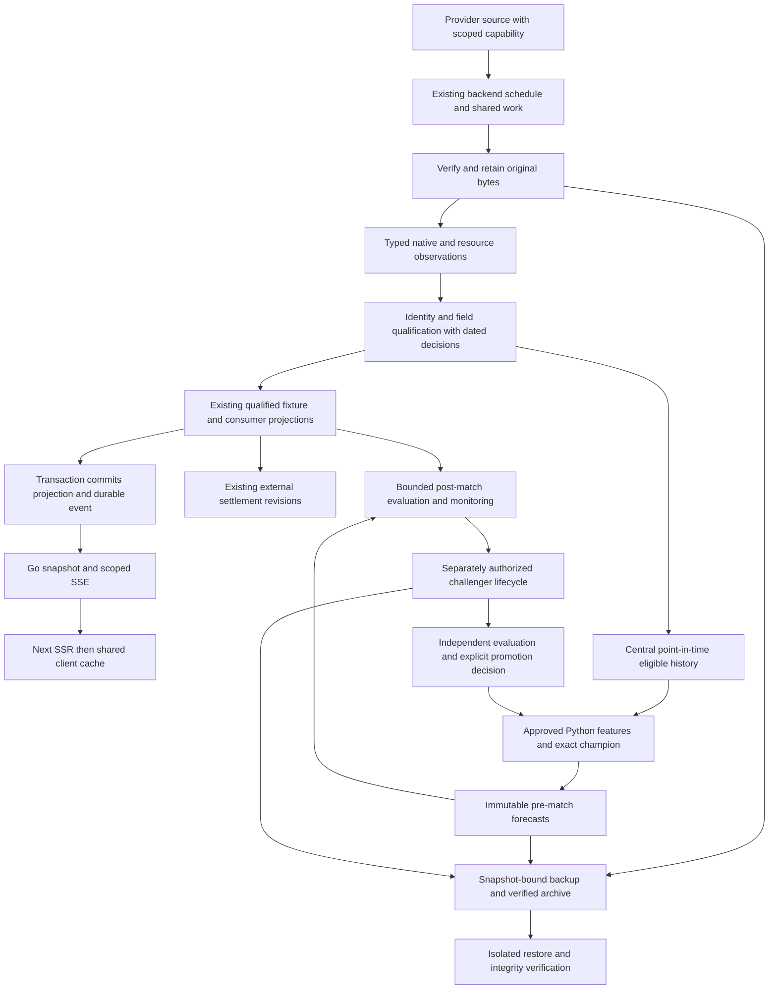

# Proposed architecture and product contracts

Checkpoint I1. Status: **PROPOSED; NOT IMPLEMENTED**. Read with
[current evidence](current-state.md), [research](research.md),
[learning](learning.md), [storage/recovery](storage-recovery.md) and the single
[implementation roadmap](roadmap.md). Existing approved contracts and owner
scientific decisions remain binding.

## Decision and alternatives

Recommend incremental Architecture V2 evolution, with small independent repairs
in existing owners. The baseline already has identity history, immutable
observations, typed normalization, canonical resolution, shared work, qualified
history, model artifacts and settlement revisions. Their existence rules out a
new general data platform as the starting point. Their uneven adoption and absent
stream/DR/learning automation rule out calling the requirements already met.

| Criterion | A: minimal fixes only | B: incremental existing owners | C: replacement subsystems |
| --- | --- | --- | --- |
| Correctness / FR impact | Fast scoped defects; source proof still required | Same scoped repairs plus coherent publication, recovery and monitoring | Still cannot create missing evidence; duplicates existing authority |
| Reuse / maintenance | Highest immediate reuse, scattered future additions | Reuse domain writers and introduce only demonstrated missing contracts | New identity, queue, API and storage migrations increase ownership burden |
| Complexity / testing | Low initially; cannot meet streaming/full DR/extension acceptance alone | Bounded cross-language contract and mixed-version tests | Broad rewrite and parity matrix before user value |
| Performance / storage | Current polling and repeated backups remain | Measured event delivery, incremental file backup and scoped rebuilds | No measured workload justifies broker, new service or feature store |
| Migration / compatibility | Minimal change but leaves stated gaps | Additive SQL/API versions; shadow compare; reversible routes | High risk to retained identities, forecasts, source hashes and running workers |
| Scientific reproducibility | Preserved if no scientific edits | Preserved through exact owners and independent gates | Numerical/data rewrite adds unnecessary reproduction burden |

B is chosen for complete coverage, not as permission to perform V2 cutover.
Independent A-sized bug repairs can ship before the larger contracts. C would
need a measured limitation the existing owners cannot solve; none was established.

## Target flow and ownership



Language ownership remains Python football/data/modelling, Rust deterministic
simulation, Go HTTP/operations, SQL schema. Redis remains disposable/ephemeral;
no Redis queue, Pub/Sub dependency, Kafka, ML platform, second identity registry,
second model registry, dynamic plugin runtime or general EAV schema is proposed.

## Identity, source facts and consumer eligibility

Keep stable MatchForge IDs and provider-native mappings. Alias/display names aid
candidate lookup only. A legal club, senior men's team, women's team, youth team,
season participation and fixture lineup are separate concepts; do not reinterpret
existing `teams.entity_kind='club'` as proof of a legal corporate relationship.
Add a specific typed relationship only when an authorized feature needs it and
source evidence establishes its semantics. Succession/merger/split is an evidenced
relationship, not a retrospective UUID rewrite. Retirement preserves earlier IDs.

Retain each structured source observation before independent decisions about:
source authenticity, byte integrity, entity identity, factual consistency,
semantic compatibility, temporal availability, forecast eligibility and consumer
qualification. Safe JSON/native validation is not a permissive path for malicious
payloads. Invalid structures fail/quarantine; unknown source vocabulary stays
explicit. Valid unresolved observations may be retained without populating
canonical facts, model inputs or a verified live score.

Reuse `identity/repository.py`, product admission/correction/crosswalk owners and
`canonical_resources/resolution.py`. Existing fully qualified exact crosswalk
rules can execute without new manual approvals. Ambiguous identity, provider ID
reuse, contradicted target or historical continuity needs evidence/review under
its actual contract. Candidate confidence cannot confer approval. Do not use
majority voting, an overall provider ranking or average incompatible xG/statistics.
An authority policy is resource/field/provider/competition/season/consumer scoped.

Correction workflow: retain original bytes → record a new source/decision with
its real known time → qualify only affected identities/fields → publish a new
projection → mark affected derived objects through existing dependency edges and
state events → enqueue bounded rebuilds. An earlier historical cutoff continues
to resolve its prior evidence. Models receive centrally eligible history and never
query raw providers/current-state tables for their own permitted universe.

### Fixture identity and duplicate prevention

Provider observation identity is provider + stable native fixture identity +
source revision/record locator; a rolling CSV row number alone is not stable.
An admitted real fixture requires proven participants, competition/season,
orientation, fixture relationship and defensible kickoff precision. An exact
crosswalk plus compatible scope can reuse an established fixture before creation.
When unsure, retain an unresolved observation instead of creating a guessed
canonical duplicate. A reschedule changes a dated schedule observation, not the
known native identity; proven provider ID reuse starts an explicit separate claim.

Reuse `history/fixture_identity.py`, `fixture_identity_resolutions`, product
reconciliation and current representative selection. Preserve source UUIDs and
historical alias decisions; public listing uses one accepted representative.
Same teams/date are insufficient for a unique constraint: season, cup legs,
replays, neutral venues, youth classifications and later reversals can differ.
Only a proven stable provider-scope uniqueness contract can be enforced at SQL
insertion. Concurrent first-seen/reconciliation uses current ordered locks,
rechecks under lock and one accepted relationship; do not remove locks to gain
concurrency. Any prospective new scope key requires populated upgrade and old-ID
compatibility tests, never renumbering existing CSV mappings.

Measure six populations separately: raw revisions, canonical rows, mapping
claims, representative API rows, rendered rows and legitimate repeated meetings.
The observed three-source season example already has accepted
`RealFixtureIdentityV1` representative decisions (see current-state supplement);
it must become a preservation regression, not another proposed merge.

### Team/player/context and competition-rule extensions

| Contract owner | Proposed minimum extension when authorized | Required semantics and failure behavior |
| --- | --- | --- |
| `player_source_facts`, source/player observations, participation and identity history | Typed membership/registration query; add relationship fields/migration only for demonstrated missing meaning | Provider/source/player/team, relationship kind, competition/season, effective interval, known interval, correction predecessor; club registration, loan, national call-up and fixture eligibility are distinct |
| `LineupObservation`, `LineupObservationV1`, `player_position_stints` | Preserve current versions; explicit later contract for partial lineups and tactical periods | Announced versus predicted versus observed shape; original formation, grid coordinates, starter/bench and period/substitution boundaries; missing grids remain unknown |
| `AvailabilityObservation`, disabled context sync and resource capability registry | Source-scoped reported availability categories and correction/expiry | Injury, suspension, doubt, rest, tactical omission, national duty, unknown and feed failure remain distinct; no empty-feed=healthy or medical inference |
| `product_standings`, qualified standing observations | Versioned competition-season rules and evidence | Points/deductions, ordered ties, splits/playoffs, awarded/abandoned results, two-leg aggregates, effective/known dates; unknown policy gives a partial source table, not an invented official ranking |
| `provider_resource_capabilities` and `resource_authority` | Exact field/resource semantics and entitlement evidence | Provider × resource/field × competition × season × processing/method version; unsupported, unknown, partial and restricted are not empty confirmed data |

A source team field in a player observation is not an historical registration
ledger. Existing lineup modes lack a distinct PARTIAL enum; do not relabel a
partial source as CONFIRMED or change old serialized bytes. New compatible
versions must explain completeness explicitly. Eleven starters per side is
checked only when a source claims a complete standard XI; incomplete observations
remain partial. No player can silently occupy two opposing sides or duplicate a
slot. A 2026 transfer cannot enter a 2024 snapshot. All context remains display-only
for the current champion; context-only refresh never fabricates a predictive
forecast revision.

Availability acquisition needs a separately approved minimal processing and
source-rights policy before activation, especially for minors and identifiable
health allegations. Store fixture-relevant reported availability, source and
certainty; avoid diagnoses/free-text medical history. Use correction/expiry and
restricted display/exports. Local non-commercial purpose does not prove provider
consent, privacy lawful basis, retention or image rights. Jurisdiction-specific
requirements remain an owner/legal input; this investigation grants no health
intake or new subscription.

## Live score and freshness contract

Reuse `operational_provider_sync.py`, `live_resources.py`, native observations,
refresh state and Go fixture/live queries. Each published score/lifecycle pair
must be bound to compatible fixture identity and score basis. Events/statistics
may have different source/freshness; never use an event goal count to reconstruct
an unverified score. Null is unknown; observed zero is zero. A scheduled-source
0–0 does not establish live play. Do not derive minute/FT from elapsed kickoff.

| Lifecycle case | Publication and acquisition rule |
| --- | --- |
| Upcoming / near kickoff | Verify native scope early; schedule from provider capability and real quota, not browser activity |
| LIVE 0–0 → 1–0 | Atomically publish qualified score/status/clock revision; preserve zero and ordering proof |
| HT / interrupted / suspended | Keep source lifecycle and last verified score; bounded continued checks, no assumed progression |
| FT delayed / correction | Continue justified final-result reconciliation; a later qualified correction creates a new revision and downstream settlement/evaluation work |
| ET / shootout | Keep regulation, extra time and penalties distinct; 90-minute consumers reject incompatible totals |
| Postponed / cancelled / abandoned / awarded | Preserve event meaning and evidence; no fabricated final or automatic market settlement |
| Conflicting / out-of-order source | Existing source-clock/football-clock rules qualify ordering; re-fetch time cannot reverse facts; unresolved contradiction withheld with reason |

Expose per resource: provider/native ID, observation and acquisition time,
provider update time if supplied, MatchForge known/publication time, last attempt,
last successful fetch, last meaningful fact revision, expected cadence/deadline,
qualification reason, retry classification/deadline and source evidence reference.
Map this onto existing fields/refresh state rather than a duplicate freshness table.

`FRESH`/`STALE`/`UNKNOWN` stay backend decisions. Preserve the old boolean only for
wire compatibility; false does not imply fresh. Fetch success measures contact;
source update measures facts; API response/cache age measures delivery. An
unchanged response may verify successful contact without inventing a new source
revision or known-at time. Where the provider lacks an update timestamp, publish
that limitation; do not turn new HTTP receipt time into proven source currency.
Use provider/resource/lifecycle budgets, not a universal three-minute deadline.

Recovery first distinguishes acquisition/quota/network, native identity/season,
normalization, canonical conflict, publication and browser delivery. Technical
retryable failures use bounded shared work/backoff/cooldown; blocked evidence
waits for an actual dependency change. Scope errors never stop unrelated providers.
Reconsider previously unresolved observations after exact mapping/season/source
changes. Each work key binds input revision and intended consumer; coalesce
repeated requests and avoid all-history refresh fanout.

## Pre-P03 result recovery

Go submits `RESULT_RECOVERY` through the existing Admin sync runner. The run
has the existing bulk-lane lease and publication fence. Python selects
unresolved canonical fixtures from `football.product_result_recovery_candidates`,
including past dates outside the live polling window. The four-hour P02 overdue
threshold selects work without assigning a lifecycle state. A finished score
that already qualified history is not a candidate only because its source gives
no match duration.

Eligibility belongs to each fixture and provider in
`football.product_result_recovery_state`, which records the last outcome and the
next check. Fixtures that share a provider's UTC kickoff date share one request.
A 15-minute lease on that date in `football.product_provider_refresh_state`
only stops duplicate concurrent requests; it is released when the date
finishes and carries no freshness delay. A checked fixture therefore never
suppresses a newly eligible fixture on the same date. An operator's fixture or
date request ignores MatchForge's own schedule. Provider deadlines and quotas
still apply to every request: they are enforced by `HistoryRequestBudget` and
the API-Football budget, and the latest provider deadline also gates the next
pass. A new exact mapping makes a blocked fixture due at once.

Each run splits its date limit between the newest due dates and the dates that
have waited longest. Retry delays grow with the fixture's age and repeated
outcome: 15 minutes to 2 hours in the first two days, up to 7 days after 90
days. No unresolved, routed fixture is abandoned. Each outcome is named:
`RECOVERED`, `CORRECTED`, `VERIFIED_UNCHANGED`, `NOT_RETURNED`,
`NOT_YET_PUBLISHED`, `SCORE_BASIS_UNAVAILABLE`, `IDENTITY_UNRESOLVED`,
`RESULT_CONFLICT`, `QUALIFICATION_FAILED`, `PROVIDER_UNAVAILABLE` or
`PROVIDER_RATE_LIMITED`. A successful request is never counted as a recovery.

FotMob and PitchAPI replay the newest validated final observation with a stated
duration before making dated requests, keeping the original snapshot and
acquisition time. Correction discovery rechecks a finished, mapped result 1, 7
and 28 days after kickoff and then stops, so unchanged history is not
downloaded again. An operator recheck of a verified fixture is always
available.

Only the established result owners publish scores or qualify history. A newer
API-Football regulation-time correction uses the existing versioned history
decision path when the preceding score was also sourced from API-Football.
Other conflicting evidence is classified as `RESULT_CONFLICT` and remains
available for review. Result and observation updates enqueue the existing
external settlement work without requiring a forecast.

History scopes can be refreshed after completion. The catalogue cache does
not control result acquisition. P03 owns live scheduling, fairness and
affected-only work, P04 owns committed events and SSE, and P09 owns broader
historical completeness and authentic source gaps.

## Work scheduling, fairness and Mac recovery

Keep `WorkRequest` semantic identity, input hash, current states, generation,
lease token and publication fencing. Go `app.go` remains schedule submission;
Python owns provider/data execution. A new schedule submits existing work, not
provider requests inside an HTTP read. Existing live lanes and manual controls
remain independent subject to real resource conflicts.

| Work class | Priority and ownership policy | Conflict and cancellation rule |
| --- | --- | --- |
| Live status/result publication | Provider-aware reserved capacity; short publications, current leases | Same native resource fetch may be shared; unrelated manual job is never cancelled automatically |
| Manual sync/recovery | Explicit requested scope, progress and cancellation audit | Reuse exact in-flight acquisition where compatible; show queued dependency rather than fail a whole lane |
| History/backfill | Bounded resource/date chunks and checkpoints; yields under live quota pressure | Retry scope separately; no long global lock or unbounded restart storm |
| Settlement/forecast/read reports | Only affected dependencies and generations | One current publication fence; preserve completed unrelated work on retries |
| Post-match/approved learning | Lower priority than live/urgent results, budgeted compute/disk | Training is isolated and cannot evict champion or last recovery copy; admission requires separate science policy |

A live/manual conflict matrix must cover same/different provider, native resource,
fixture, competition, publication rows and quota bucket. Concurrent independent
scopes proceed; actual shared quota and ordered database locks remain enforced.
Measure oldest runnable age and per-class service, not just priority numbers.
Freeze fairness bounds against measured publication and provider deadlines in
P00/P03. One long history batch cannot consume the entire live request reserve.
No speculative new worker pool or second persistent queue is needed.

On sleep/reboot/offline/clock jump: treat database lease expiry as authoritative,
reject old tokens, find gaps since the actual last successful resource version,
coalesce missed windows, reserve live capacity and resume bounded checkpoints.
Do not blindly replay every timer tick. Time schedules are UTC; display and
selected-day boundaries honor Africa/Lagos. A resumed source or VPN failure
cannot make old facts fresh. Backup-disk loss blocks that backup only and cannot
silently discard the last good recovery chain. Optional launchd supervises the
existing backend owner; it does not acquire providers or run competing fits.

## Committed events and browser synchronization

SSE is the proposed browser transport. The current use case is one-way state
updates; WebSockets add bidirectional session/protocol work without a demonstrated
consumer. Provider webhooks are an optional adapter capability only when verified;
no supported FotMob/PitchAPI webhook was established by repository/public research.
Upstream polling remains backend-owned. No broker/Pub/Sub service is justified.

### Transaction, ordering and retention

P04 must add the smallest durable event log in PostgreSQL around existing
qualified publication. Prepare bytes outside locks; transactionally validate
current work fence, publish projection and append its event. Send only after
commit. An aborted/rejected observation must not produce a fixture-value event.
Provider failures can publish separate provider-health/work events without
claiming a canonical score update.

A database sequence or UUID is **not a commit-order checkpoint**. Proposed
ordering: one monotonic committed counter per bounded stream scope (for example
competition or owner-admin work), updated under a row lock held until commit.
Writers acquire multiple scope locks in the established global order. One owner
assigns fixture entity versions; competition moves/redirects publish atomically
to affected scopes. Counter allocation and projection/event publication share the
transaction, so an earlier offset cannot commit after a later offset in that
scope. Benchmark contention before accepting this targeted serialization; do not
add network I/O or artifact preparation under the scope lock.

An event envelope needs schema/contract version, stable change identity,
stream scope and committed offset, fixture/job ID, previous/current entity
version, real publication time, change reason and qualified payload or invalidated
resource identifiers. Reuse existing projection/decision IDs, source/checksum
references and work IDs. Wire payload contains no raw provider credentials,
licensed raw body, filesystem path or model training payload. It preserves null,
zero, period and uncertainty. A correction/redirect retains original IDs and
forecasts; clients follow the current relationship without rewriting old records.

`LISTEN/NOTIFY` can wake the Go reader after commit; the durable table is the
replay source. A missed notification or restart must not lose an event. Reader
catch-up is bounded; any internal wake/poll concerns backend implementation, never
a permanent browser polling fallback. Retention is a measured replay horizon,
backed by snapshot recovery and required audit retention; it is not deletion of
source/identity/forecast evidence.

### Snapshot, resume and stale response protection

```mermaid
sequenceDiagram
  participant B as Browser
  participant N as Next server
  participant G as Go API
  participant D as PostgreSQL
  N->>G: Authorized snapshot for selected scopes
  G->>D: Repeatable-read values plus scope offsets and entity versions
  D-->>G: Consistent snapshot and checkpoint vector
  G-->>N: Typed authorized snapshot
  N-->>B: SSR values plus checkpoint
  B->>N: Same-origin SSE resume from checkpoint
  N->>G: Server-authorized scoped stream
  G->>D: Replay committed offsets after checkpoint
  D-->>G: Ordered authorized events
  G-->>N: Entity versions and opaque resume checkpoint
  N-->>B: Authorized event stream
  B->>B: Apply next version once; discard stale responses
```

Each snapshot reads projection versions and scope counters in the same read-only
snapshot. A selected-scope checkpoint is an opaque validated resume token encoding
the scoped offsets; it is not a new identity authority. A single global sequence
cannot substitute. `Last-Event-ID` resumes the bounded scope vector. A changed
filter or unauthorized/expired token requires a fresh authorized snapshot.

One application connection/cache manager serves collapsed fixtures, expanded
panels, provider history and model health subscriptions; do not add one manager
per new feature. Duplicate change IDs are ignored; older entity versions cannot
overwrite newer snapshots. A missing predecessor, retained-offset gap, unknown
incompatible schema, changed permission or projection reset causes one bounded
snapshot revalidation with request cancellation/generation protection. Unknown
additive fields are tolerated; unknown semantics are unavailable, not coerced.

On disconnect/offline/tab resume, display delivery state and last verified data;
do not certify an old live score as current. Reconnect uses bounded backoff/jitter,
server retry hints and a snapshot when replay is impossible. Use one connection
per app/tab initially; test multiple tabs within measured capacity before adding
cross-tab coordination. Slow clients have bounded queues and are disconnected
with recoverable checkpoint semantics rather than growing memory indefinitely.
Heartbeats carry liveness, not invented source freshness. Do not replace a lost
stream with permanent `setInterval` HTTP refresh.

Remove fixture/live/context/Sync Admin/performance HTTP timers only after their
replacement's contracts and failure matrix pass. The one-second local elapsed-time
label may remain; it does not fetch data or establish source freshness.

## Settlement and Live Sync History

Reuse `external_prediction_recovery.py`, bounded settlement batches, binding
history, result revisions and source-accuracy readers. Add a distinct authenticated
Admin **Settle External Predictions** job action for selected dates/sources;
collection and settlement are separate operations. Preview counts before enqueue;
never calculate WON/LOST in React. Validate current fixture binding, period,
selection/line, regulation basis and authentic final result under current fence.
Unresolved/incompatible results remain pending with their actual reason.

Repeated/correction jobs converge to one logical result revision per prediction,
input evidence and policy. Lock the same prediction/fixture scope in repository
order, recheck source/binding revision before commit and append the new decision.
Allow WON→LOST, resolved→PENDING or VOID only when the policy and new evidence
justify it. Preserve all previous decisions. Queue only affected accuracy/report
refreshes; source statistics read the effective revision. Publish committed
progress/outcome events and explicit blocked/retry summaries. Automatic verified
result/correction publication queues this same workflow; browser presence is not
required. Extending shared work registration needs a distinct work type only if
none of the existing domain adapters can express that operation safely.

Plan `/admin/live-sync` as a request-rendered, backend-paginated read view over
existing sync/work/attempt metrics, distinct from general Data Sync. Default:
provider, last attempt/success, next scheduled/retry time, valid lease state,
duration, fixtures examined/updated, score/status changes, new bindings,
unmatched/conflict/failure counts, quota and resource freshness. Filters:
provider/time/status/competition/error/fixture. Names and dates are primary;
copyable job/native IDs and fencing generation are advanced details. Missing
metrics are unknown, not zero. Snapshot and event scopes are shared with Admin
work; the page does not own a scheduler.

## Market, horizon and model selection

Extend existing `MarketDefinition`, `market_catalogue.py` and `products.py`;
separate target definition, source support, model output, publication eligibility
and sportsbook settlement. A market identity binds selection, exact line/units,
period, score basis and semantic version. Do not create a second catalogue or
probability-filter initiative.

| Product | Precise meaning and compatible source |
| --- | --- |
| Regulation 1X2 | HOME `h>a`, DRAW `h=a`, AWAY `h<a` from one approved regulation joint score distribution |
| Double chance | Disjoint unions of the same three outcomes; no new independently fitted probabilities |
| Goals totals / team totals | Exact strict inequality at declared line and period; integer/quarter lines retain push/half-win/loss partitions from existing projections |
| BTTS | Both regulation team scores strictly positive; complements use identical support and unresolved-tail policy |
| Exact score | Exact `(h,a)` atom only; a `5+` censored bucket is not exact five goals |
| Period, cards, corners, players | Require their separately qualified inputs, output distribution, target semantics and model authority; full-time goals do not imply these capabilities |

Internal probabilities remain finite `[0,1]`; percentages multiply by 100 for
display only. Preserve decimal/quarter-line precision and units; no rounding
before eligibility/settlement. Sum/complement/marginal checks use the existing
approved mathematical tolerance and tail bounds. Invalid distributions fail;
no silent clipping or renormalization. A newly named market cannot relabel an
unrelated probability or treat research coverage as sportsbook equivalence.

Use existing pre-match selector: one revision per fixture/model/horizon,
`LATEST` or latest eligible issue before the explicit minimum lead-time cutoff;
ties use issue time then forecast ID. Issue/football/knowledge cutoffs stay before
kickoff. Rescheduling requires preserving the issued fixture snapshot and policy
version; do not retrospectively make an old issue meet a new horizon without an
explicit compatible selector. Current route/model changes affect future serving,
not earlier forecast/artifact bytes. Missing, corrupt, incompatible or RETIRED
approved role fails unavailable; no latest-challenger substitution.

## Product experience and data delivery

The inspected `app-shell.tsx` already uses top navigation, so a sidebar removal is
not a new defect everywhere. Preserve no permanent sidebar and inline collapsible
match details. Authoritative HTML references include desktop collapsed fixtures,
expanded overview and External Predictions under `web/ui-designs/`; their sample
IDs/personas/live labels are design examples, not data. Owner functional and
uncertainty requirements override static misleading sample content.

| Current page/data | Existing limitation | Proposed contract |
| --- | --- | --- |
| Fixtures and expanded overview | Full selected-day lists and HTTP timers; context/live fetches after expansion | Typed SSR snapshot, backend filters/sort/page state for collections, one versioned cache/subscription and inline sections |
| Performance | Backend competition paging exists; periodic client refresh remains | Preserve metric policy/horizon; SSR first page, cursor/offset appropriate to scope, committed invalidations |
| External Predictions | API/UI page/page-size controls exist | No user-visible pagination; complete date/filter-scoped snapshot with stable internal chunk cursor, count and resumable continuation; virtualized rendering with accessible table/list alternative |
| Data Sync | Dynamic server shell supplies date; client loads status/history | Authorized server initial data, paginated run history and small mutation/subscription islands |
| Resolution Center | Server shell renders client data loader | Authorized initial filtered page, current preview/apply contracts, stale-preview rejection and event invalidation |
| Forecast/history/statistics/evidence collections | Different endpoint and bounded-list semantics | Backend-managed filtering/sorting/page metadata for each table; no client-only paging of an entire downloaded history |
| Storage/backup/model health/data quality | Proposed/partial operational views | Extend existing Admin navigation and typed API; no separate Admin application |

For standard tables, stable ordering ends in immutable ID. Offset is acceptable
for bounded static snapshots; keyset/checkpoint cursors handle frequently changing
or large collections. Pin a snapshot population/version for multi-chunk traversal
or explicitly restart with a visible changed-population state. Counts describe
the same scope; do not add expensive exact scans if a documented count estimate
or unavailable count is appropriate. Never claim an incomplete list is complete.

For External Predictions, internal chunks are transport only: scrolling can
continue through every selected record, no hidden result cap or page controls.
A server-issued population token/manifest binds filters, sort and collection
revision without retaining an indefinitely open database transaction. Retain
bounded chunk/cache windows; offer continuation/retry and accessible traversal
when virtualization unmounts distant rows. Counts/consensus cover the complete
scope, not just rendered rows. Unauthorized or excessive broad scopes require a
clear narrower date/filter request; no silent truncation. Do not stream all history
into an unbounded React array.

Match research sections: overview/timeline; recent form/home-away comparison;
qualified H2H; standings/rule context; source-specific statistics/xG; lineup and
availability where supported; immutable forecast/score distribution/history;
concise availability reasons and advanced lineage. Use normal typed React
composition: section identifier, resource/identity requirements, server query
owner, capability/rollout condition, label and loading/empty/partial/error states.
No runtime plugin registry or browser domain calculations. Deferred team/player,
formation and injury pages stay in companion F1–F6, not hidden core criteria.

Central wording examples: “Most likely score”, “Expected goals”, “Not enough
verified match history”, “Conflicting match information”, “Latest update not
confirmed”. Expected goals is a forecast/model quantity where applicable, not an
actual score or provider xG unless labelled so. Technical metrics remain precise
in methodology/advanced views. Remove repeated strips, disabled “Soon” controls,
debug copy and raw UUID-led rows only in later authorized UI slices; retain
uncertainty, source attribution and meaningful action consequences.

SSR acceptance includes actual authorized HTML data, server-side error/empty
states, exact hydration parity, no duplicate initial client request, no credential
serialization and no cross-request sensitive cache. Server-only access reuses the
existing Admin credential; if absent, show unavailable rather than spoofing a
trusted browser Origin. Existing API, Go handler and parser definitions evolve
together; do not replace the stack.

## Single-owner threat model and release truth

| Trust boundary / threat | Existing control / proposed requirement | Exact negative acceptance scenario |
| --- | --- | --- |
| Local Admin mutation / DNS rebinding or CSRF | `admin_access.go` loopback bind/peer/Host, exact Origin or server token, JSON body, preview/evidence version | Host/port mismatch, hostile Origin, missing token, wrong content type and stale preview return denial with no work/domain mutation |
| Next SSR and mutation proxy / credential or cache leak | Server-only credential and authorized local request scope; sanitized DTOs, private/no-store for sensitive data | Token absent or unauthorized request cannot fetch Admin data; token never appears in HTML, JS, URLs or shared cache |
| SSE / cross-origin reading or stolen resume token | Same-origin Next proxy for Admin stream; server-held token, scoped authorization on connect/resume/replay, bounded validated cursor | Native EventSource needs no browser Bearer secret; hostile Origin/Host or unauthorized scope cannot read events; no query-string token |
| Imported URLs/files/archive / SSRF and traversal | Existing source/path/checksum owners; allowlisted provider routes, safe relative paths, symlink checks and bounded decompression | `../`, absolute path, symlink escape, archive bomb, redirect to loopback/metadata host rejected before publication |
| Raw source/provider secrets | Restricted local files, redacted logs, account-scoped clients; retention and access ledger | Failure logs and event payloads expose no credentials or raw licensed bodies; revoked entitlement blocks that source only |
| Backup/restore / key loss or overwrite | Restricted encrypted destinations and separate recoverable keys; isolated default target, exact manifest and disk check | Wrong key, corrupt dump, absent model/source, disconnected disk and operating target all fail without operating overwrite |
| Worker concurrency / stale actor | Ordered locks, current lease/generation and publication fence; bounded child process rights | Expired old token cannot publish after successor claim; cancellation cannot delete completed unrelated output |
| Release / wrong binary or missing migration | Running `/version`, lock/build ID, API version, full migration IDs/checksums, selected model and route evidence | Current `unknown` build or missing `202611100200` blocks a current-release adoption claim even with `/readyz` 200 |

Native EventSource cannot set a custom Authorization header. Do not solve that
with a persistent secret in a URL; authorize the local server proxy and its
incoming request first. HTTP CORS is not authentication. Heartbeats/checkpoints
must not reveal unauthorized job/source details. Current private-local controls
are the scope; public exposure needs a new authenticated/TLS/session/CSRF review
and owner authorization, not speculative multi-tenant infrastructure now.

Implementation ticket progress, valid backend work lease, domain result,
scientific acceptance and operating rollout are separate fields/views. A work
item can be SUCCEEDED with a BLOCKED report. A task IN_PROGRESS with no valid
worker lease is not running work. Release proof compares running provenance to
tested commit/lock, every applied migration and checksum, active model bytes,
route flags and dated HTTP/worker observations. Changes preserve that evidence
rather than generating green labels from repository text.

## Measurable acceptance and unresolved budgets

Correctness bounds are strict: no known lost committed events in replay cases,
no duplicate public representative for proven fixtures, no stale-version
regression, no null→zero coercion, no unauthorized read/write, no changed
published forecast, no protected-outcome access and no unverified recovery PASS.

Performance numbers are not yet release SLOs. P00/P03/P04 must freeze workloads
and numeric limits before rollout: active-provider/fixture concurrency, manual
coexistence, cold/warm DB query plans, event lag and replay retention, payload/
bundle/DOM/memory peaks, backup/restore workspace and optional training cost.
Baseline evidence includes 30-second backend scheduling, 45-second visible-tab
fixture polling, 2.5-second active Admin polling and measured API request sizes.
A proposed event replacement must improve same-workload request volume and
commit-to-browser delay over those mechanisms without weakening publication or
live/manual fairness. Compare p50/p95/p99 and oldest runnable age; a single audit
request cannot set a percentile. Source delay/coverage is reported separately
from internal propagation. Budget not frozen or measured means release blocked,
not permission to invent a latency/sample threshold after observing results.
