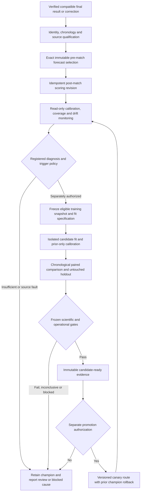

# Governed continuous learning design

Checkpoint I1; **PROPOSED, NOT OPERATING**. No fitting, calibration, protected
outcome access, scientific experiment, registration or promotion was performed.
Existing model governance, frozen decisions and failure dispositions remain
unchanged. This design extends current Python owners and shared work.

## Actual maturity and reusable contracts

| Capability | Evidence / current state | Target change |
| --- | --- | --- |
| Data adaptation | Existing rolling-last-10 feature path; 18,162 stored forecasts bound to the same approved artifact | Record eligible feature snapshot refresh separately from a parameter fit |
| Post-match scoring/monitoring | `postmatch.py`, `postmatch_storage.py`, CLI/schema/integration tests exist; zero operating evaluation rows and no automatic schedule found | IMPLEMENTED_UNSCHEDULED → independently verified continuous evaluation |
| Candidate training/evaluation | Fit/artifact, experiment, calibration, holdout, evaluation and lifecycle owners exist; closed and blocked research routes remain | Authorized hypothesis/policy/snapshot/holdout → bounded reproducible shadow candidate; not general auto-search |
| Production improvement | Explicit promotion governance; runtime registration table empty; all current forecasts retain the approved champion hash | Separate promotion event and reversible route only after independent evidence and explicit authority |

The approved retained model is `transferable-rolling-goals-poisson-v1`, artifact
`e856dedf1879135eea547ac00d7e6243621dd6ff5c59164c6697131e22e46eb4`.
`config/models/current-champion.json` references that artifact and the historical
negative V3 evaluation. Compatibility import is not a new scientific acceptance.
Do not hard-code this discovery as a future migration selector; resolve and verify
the actual approved route/artifact at that release. Original and rolling10-v2
forecast algorithms remain separate lineage despite sharing the fitted artifact.

`postmatch_storage.py` already captures exact pre-match selection, result and
policy inputs, claims `POST_MATCH_EVALUATION`, scores outside locks, revalidates
under publication locks and writes checksum-bound immutable revisions. Monitoring
already supports proper scores, calibration, entropy, competition/season/horizon
segments and missing CRPS. Reuse it. Its coverage denominator is **published
forecasts**, not all potentially eligible fixtures, and quality tier is UNKNOWN.
Those explicit limits require extension before promotion comparisons.

## Lifecycle and immutable evidence

Observation validity, training eligibility, evaluation eligibility, serving
eligibility and promotion authority are independent. Verified data does not
activate a feature/model. New outcome evidence never changes issued pre-match
probabilities. A result correction creates a new score/evaluation revision and
may invalidate a comparison population; it cannot rewrite forecast cutoffs or
pretend the corrected fact was historically known.

| Requested conceptual record | Existing representation to reuse | Necessary additions only when authorized |
| --- | --- | --- |
| OutcomeEvaluation | `post_match_evaluation_inputs`, `post_match_evaluations`, `post-match-evaluation.schema.json` | Explicit qualified result-revision/score-basis linkage and denominator evidence where existing fields cannot express it |
| LearningTrigger | Shared `WorkRequest`, immutable experiment protocol/decision references | Registered policy, evidence revision, RUN/SKIP/REVIEW/BLOCKED reasoning and budget; not another queue |
| TrainingRun | Fit specification/identity, model artifacts, existing execution/experiment records | Exact snapshot, fit/lease/checkpoint/resource evidence and calibration lineage |
| ChallengerEvaluation | Existing evaluation protocol/run/result and paired scoring | Frozen eligible population, matched target/horizon set and coverage/segment shift accounting |
| PromotionDecision | Existing append-only governance decision/promotion events | Exact evaluation/artifact/previous route, approved effective time, canary/rollback evidence |
| ModelHealth | Read-only projection over those records | No new authoritative health registry; derive maturity and blocked reason from actual jobs/results/routes |

These names describe responsibilities, not six mandated new tables/classes.
Any schema extension must preserve old serialized artifacts and use versioned SQL
migrations. Scientific IDs and logical run identity remain distinct from work IDs
and execution attempts. Finishing a process is not scientific acceptance.

## Outcome selection and score revisions

For a bounded competition/window/horizon: select one existing published forecast
strictly before kickoff and compatible with original football/knowledge cutoffs;
retain exact fixture, issued time, algorithm/artifact, input/payload hashes,
selection/scoring policy and original horizon. Require independently qualified
regulation final result or explicit compatible market period, result known time,
source/hash and correction predecessor. No outcome inferred from goal events,
fuzzy names, similar websites, elapsed time or unqualified ET/shootout totals.

Map operator reasons onto existing availability/work states: waiting for result,
identity unresolved, incompatible basis, result not yet known, scorable, scored,
corrected, insufficient evidence or retryable technical failure. These are
explanations, not a second persisted status machine. Unverified identity remains
blocked even if its plausible score would improve accuracy.

Semantic work identity binds forecast, horizon, qualified result revision and
scoring policy. Repeated attempts converge. Before publication recheck that
binding/result/policy still match; lost lease or changed input cannot publish.
Corrections append new inputs/results; previous score records remain readable at
their original knowledge cutoff. Bound candidate scans and invalidations by exact
dependency/fixture changes; no full-history scoring storm after each backfill.
External Predictions settlement consumes compatible canonical results separately
and cannot impersonate an official forecast evaluation.

## Monitoring and fair comparison

Reuse proper scores: Log Loss, Brier and RPS under current event contracts; CRPS
only for a genuinely supported full count distribution. Existing champion CRPS
validates Poisson parameters, algorithm/artifact and compact grid first. A censored
5+ display matrix alone is insufficient. Invalid/nonfinite probabilities fail
unscorable; do not clip/renormalize or silently extend existing score floors.
Report original score definitions and units; entropy in nats describes sharpness,
not probability of correctness.

Maintain separately frozen counts:

- Potentially eligible fixture population at forecast cutoff, with scope/version.
- Fixtures with issued eligible forecasts; abstentions and their known reasons.
- Qualified outcomes available at the scoring cutoff and unscorable causes.
- Champion/challenger matched fixtures and horizons; each model's unmatched
  population, coverage denominator, exclusion reasons and segment distribution.

Compare quality on the same matched population, and report coverage against the
same eligible denominator. Do not assign fabricated probabilities to abstentions
or claim higher accuracy on a smaller/easier selected set is improvement. Report
backfill/provider/competition mixture shifts and target deduplication. A corrected
result/population changes comparison identity; prior claims remain historical and
must be reassessed under the frozen correction policy.

Calibration includes reliability curves, uncertainty, intercept/slope where
estimable, class balance, sharpness and tail behavior. Segment by competition,
season, home/away, horizon, prior history/cold start and pre-match source quality
only when that field was captured at issuance. UNKNOWN remains UNKNOWN; later
qualified quality cannot backfill it. Recent and longer reference windows are
separate views, not reusable untouched evaluation sets.

Metrics: verified-final-publication→scoring lag; scoreable/unscored backlog;
identity/score-basis exclusions; oldest pending age; attempted/succeeded/blocked
jobs; CPU/RAM/disk; calibration and input/missingness/output/residual drift.
Distinguish provider outage and data selection from model degradation. A surprising
outcome or high-confidence miss alone is not drift evidence.

Use the existing paired uncertainty implementation for chronological comparisons;
predeclare whether block/bootstrap units are time batches/competitions and why.
Freeze primary/secondary metrics, practical margin, uncertainty method, mandatory
segments, effective sample floor, coverage, multiple-testing and stopping policy
before protected outcomes. No new numerical scientific thresholds are selected
by this architecture task. Insufficient, FAIL or INCONCLUSIVE evidence retains
the champion and failed candidate records.

## Trigger, fitting and protected-data policy

Start the independently authorized automation with **monitoring only**. Compare
calendar, new-data-volume, validated drift, source-correction and performance
triggers. Proposed first fitting policy is a coalesced periodic review plus
qualified-new-data/correction gate for one pre-approved family; drift opens a
registered diagnosis/review, not unrestricted model search or live weight change.
No retrain-after-every-match policy is justified by observed capacity or samples.
Minimum new data, cadence, maximum candidates and fit resources must be frozen
in that later scientific/resource policy; absent policy yields BLOCKED_POLICY.

A fit requires: authorized hypothesis/family/features; source/identity/period
qualification; a content-addressed eligible training snapshot; actual football and
knowledge cutoffs/mode; disjoint development/calibration/independent evaluation;
forbidden-target manifest; code/algorithm/dependency/serializer versions; seed,
configuration, dataset/feature hashes, numerical tolerance and fit identity.
Historical unknown ordering is excluded conservatively; same-kickoff forecasts
all freeze before outcomes update state. Today's corrected facts or roster cannot
become knowledge in an old forecast.

Training, shadow and serving use the **same point-in-time feature transforms**.
Differential vectors must match units/null/category/normalization/correction rules
and numerical tolerances across fit/reload/shadow/serve. A feature-definition
change is a new version/snapshot, not a silent recomputation. Calibration uses
prior out-of-sample predictions only and has its own immutable fitted lineage.

Reuse existing protected-corpus/firewall and replacement-holdout owners. Mark
unspent versus already inspected/selection-used targets through existing policy
records; do not invent a fresh holdout label for a spent corpus. Protocol freeze
and execution access must precede reading protected outcomes. Previously closed
PitchAPI/shared-pace/DC and other routes remain closed. Outcome, feature, policy,
source, model or numerical mismatch fails closed before scoring/promotion.

The same logical snapshot/specification/lock/seed must reproduce logical model
state and approved predictions within existing tolerances; changed inputs create
a new immutable artifact. Publish files atomically before registration, verify
reload/checksums, and converge after failure between file write and DB commit.
Preserve rejected/inconclusive candidates, run attempts and original evidence.
No canonical pickle/joblib/cloudpickle artifact or autonomous source-code changes.

Shared work owns deduplication, lease generation, watchdog, bounded candidate
concurrency, cancellation and checkpoints. Fit CPU/RAM/temp/disk quotas are lower
priority than urgent score/result publication. Initially allow only one admitted
candidate execution at a time unless the resource rehearsal proves safe additional
capacity; actual CPU/RAM/time/space limits require that rehearsal. Disk pressure,
quota, missing artifact or cancelled job cannot evict active champion, stop
unrelated live lanes or publish partially verified state.

## Promotion and operator experience

Promotion remains a separate explicit owner/policy decision under
`docs/model-governance.md`; neither retraining nor one improved metric nor an
independent PASS automatically enables it. Require exact immutable evidence,
source/temporal/leakage/coverage/holdout and operational gates, compatibility,
versioned serving route, canary measurements, kill switch and prior-champion
rollback. A missing/RETIRED approved artifact returns unavailable; rollback is an
explicit approved prior route, not an implicit latest challenger fallback.
Previously issued forecasts keep their exact model and probability bytes.

Compare automatic-promotion policy only as optional future research: it requires
separately approved sample/coverage/harm/practical-effect bounds, multiple-testing,
reapproval on policy change, canary and audit. It is not the selected initial
mode and is not authorized by this brief.

Admin Model Health & Learning uses SSR and existing performance/operations/API
owners: active verified champion, last score/result cutoff, coverage and exclusions,
monitoring lag, last snapshot/fit, candidate evaluation outcomes, actual lease/
retry/blocked cause and promotion review. Primary text distinguishes NOT_CONFIGURED,
MONITORING_ONLY, TRAINING_BLOCKED, CHALLENGER_EVALUATING, PROMOTION_REVIEW, ACTIVE
and DEGRADED as derived display labels mapped to actual contracts. An empty
post-match table cannot produce ACTIVE learning. IDs/hashes are copyable advanced
details. Backend events invalidate authorized read models; the UI does not fit or
select a winner. Backup/restore includes all snapshots, artifacts, protocol/holdout
state, score revisions, decisions and work/checkpoint lineage.

## Required deterministic acceptance matrix

All rows are **future tests**, not passing experiment claims. Reuse unit and
integration `test_postmatch.py`, work/fencing tests, model/feature/artifact tests,
protected evaluation tests and existing Go/Next/Playwright harnesses. Add only the
missing scenarios in P16/P17 under separate authority; use synthetic fixtures
until real scientific execution is explicitly allowed.

| # | Scenario / harness | Required result |
| --- | --- | --- |
| 1 | Post-match unit + DB: pre-kickoff frozen forecast, later final | One score per exact scoped input/policy |
| 2 | Point-in-time/feature and same-kickoff batch tests | No same/future-batch outcomes in earlier inputs |
| 3 | Post-match correction/replay DB test | New append-only score; original forecast and cutoff bytes unchanged |
| 4 | Identity/basis post-match fixtures | Ambiguous alias, unqualified observation or ET-only result excluded |
| 5 | Forecast revision and model-health contract | Rolling-history refresh recorded as data adaptation, never a refit/promotion |
| 6 | Trigger policy with too little new verified data | SKIP/BLOCKED with exact reason; no fit work |
| 7 | Source outage and changed missingness population | Data fault separated from model-drift claim |
| 8 | Work DB crash/retry/lost-token concurrency | One logical fit/evaluation, old worker cannot publish |
| 9 | Dependency/invalidation bounded fanout | Only changed eligible descendants queued; no full historical scan storm |
| 10 | Resource failure injection | Candidate fails/pauses safely; live sync and approved artifact remain usable |
| 11 | Fit/reload/repeat on synthetic or authorized snapshot | Same logical hashes/tolerance; changed snapshot creates different artifact |
| 12 | Better development score, failed final/coverage/subgroup gate | No promotion; failed evidence retained |
| 13 | Small/inconclusive paired uncertainty | No promotion despite higher apparent win rate |
| 14 | Protected target, unauthorized feature or post-hoc tuning | Fail before outcome access/fit; preserve firewall evidence |
| 15 | Separately authorized synthetic promotion rehearsal | Versioned canary/audit/rollback; previous forecasts/artifact readable |
| 16 | Source/input/model/policy/checksum/version mismatch | Fail closed, no substitution or partial publication |
| 17 | Live/manual/history plus candidate contention | Measured fairness/quota/lock bounds pass; unrelated work not cancelled |
| 18 | Full isolated restore | Training/holdout/evaluation/promotion/work lineage intact; missing file blocks complete recovery |
| 19 | Admin/API/browser maturity states | Actual schedule/lease/result/route shown; empty or expired work never ACTIVE |
| 20 | Disposable end-to-end synthetic loop | Final→score→gated snapshot→fit→untouched comparison→explicit test authorization→registration→rollback; all negative gates asserted |

Before any operating learning claim, freeze and measure data/coverage, scoring lag,
compute/storage and current champion-route baselines. Missing samples or policy
is a real gate; it does not prevent independent confirmed-context display work.
