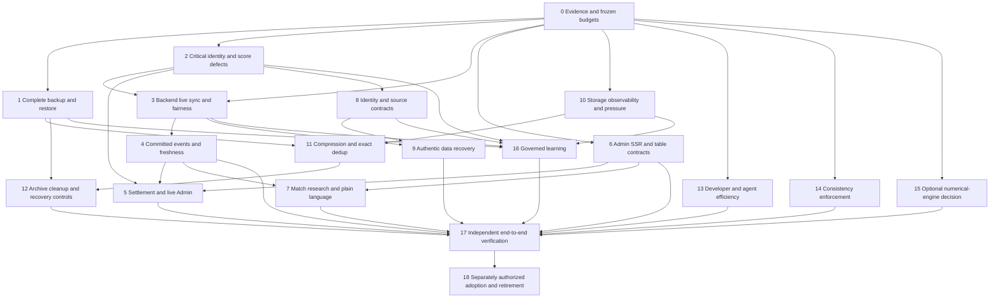

# Single phased implementation roadmap

Checkpoint I2. Status: **PROPOSED — NO IMPLEMENTATION PHASE AUTHORIZED BY THIS
INVESTIGATION**. IDs P00–P18 preserve the task's established phases 0–18; they
are not the earlier Architecture V2 phases 35/36. Investigation checkpoints
I0–I3 are separate documentation commits tracked in `CURRENT_TASK_STATUS.md`
(a local, git-ignored tracker).

This is the primary roadmap for the unified redesign (architecture, recovery
and platform work). Root `PLAN.md` stays the control-plane roadmap: its
invariants, gates and research sequence apply to every ticket here, and it is
not rewritten by this proposal. Earlier FR reports are historical inputs, and
the companion [F0–F11 product plan](../../../MatchForge_Post_Redesign_Extensible_Football_Product_Implementation_Plan_v2_2026-11-09.md)
follows this roadmap's foundations. None is a competing instruction to
implement the same work twice. Existing resolved owner and scientific decisions
outrank this proposal. Commit/verify each authorized
implementation ticket before starting its dependent ticket. Stop at each required
phase/Wayfinder owner handoff. Do not start these tickets merely because this
investigation is complete.

## Shared ticket contract

Every ticket below inherits all of these requirements; its row supplies the
specific objective, files, source/test/rollout changes and evidence. A row is not
ready for execution until its applicable prerequisites and authority are real.

- **Source and data:** exact selected provider/resource/competition/season/native
  IDs, source bytes/manifest/checksums, qualification and real known/effective
  times; current consumers inventoried before edits. Unknown or source-only data
  stays excluded from verified facts/model inputs. No historical UUID, source,
  forecast/artifact, frozen protocol or published probability rewrite.
- **Boundaries/compatibility:** existing Python/Rust/Go/SQL owners; SQL is schema
  authority. Extend existing schema/OpenAPI/Go/TS/model/observation versions only
  when needed; test N/N−1 and retained historical readers. No duplicate queue,
  registry, validator, source store or speculative helper. The acceptance and
  domain details in [design](design.md), [learning](learning.md) and
  [compatibility](acceptance.md) are inherited by affected tickets.
- **Concurrency/security/resources:** current shared work semantic key/input hash,
  lock order, lease/generation/publication fence, bounded retries/checkpoints,
  cancellation and source-specific quota; preserve live/manual independence.
  Freeze CPU/RAM/temp/disk/WAL/provider/query/latency limits from P00/P03
  measurements before rollout. Missing budget is a release blocker. Local Mac
  capacity is 16 GiB / 8 logical CPUs, not permission to saturate it.
- **Backups/rollout/rollback:** verify a complete snapshot-bound backup and isolated
  recovery before risky operating migration/cleanup/adoption; code and disposable
  fixtures may progress earlier. New serving/worker/UI behavior starts disabled
  or shadow, with a scope-specific route/switch and prior-service rollback.
  “Switch” means a proposed release control unless an existing one is named;
  do not pre-create every hypothetical environment flag. Rollback keeps additive
  schema and immutable evidence; destructive migration/eviction needs explicit
  separate authorization. If a future ticket adds `.env.example` variables, add
  them to an existing `.env`, preserve local values and never commit `.env`.
- **Verification/DoD:** reproduce the current failure or establish a new feature
  contract; red/green behavior tests where practical; deterministic positive,
  boundary, failure, retry and current/historical regressions. Use synthetic
  fixtures before separately authorized real scientific runs. Record exact
  executed commands/results, frozen workload, before/after metrics and source/
  artifact hashes. Run applicable focused checks during development and one final
  aggregate `env -u DATABASE_URL -u TEST_DATABASE_URL -u FOOTBALL_DATABASE_URL -u
  FOOTBALL_DATA_ROOT make check integration` after final code changes, using only
  disposable targets and verified existing infrastructure. Read target scripts
  before running; never let a generic aggregate override operating safety.
- **Delivery:** update existing owning docs/contracts and `docs/project-status.json`
  where durable behavior changes. Review full/staged diff, secrets/local files,
  current consumers/dead code and `git diff --check`; commit the bounded ticket.
  Implementation delivery follows `docs/git-delivery.md`; every fresh push has a
  reviewable PR. Code PASS, work SUCCEEDED, scientific PASS and operating adoption
  remain distinct. No guessed outcome, missing-byte repair or tuning after
  protected results can be hidden behind a green engineering check.

## Dependency graph and independent work

Arrows constrain affected rollout, not all code development. P00 read-only
refresh, source-proof research, P02 defect fixtures, P10 inventory and P13/DX can
progress independently. P06 typed SSR/table work can be built before P04 but must
not remove live timers until replacement passes. Monitoring design and storage
contracts can progress while data qualification blocks fitting. Optional P15
retain decision and deferred/unauthorized scientific fitting are explicit scope
outcomes, not reasons to fake their gates or block unrelated verified static
features. Concurrent edits to the same owner need one active ticket/checkpoint;
no competing local checkouts or workers are implied by this graph.

## Phase 0 — Current-state evidence and release criteria

Prerequisite: a new owner-selected implementation scope. Reuse this investigation
rather than start another architecture-wide audit. Pure inspection has no
operating mutation. Dependencies below use P00 as the scoped refreshed baseline.

| Ticket | Objective and exact owners / contracts | Validation, accepted output and rollback |
| --- | --- | --- |
| P00-01 | Refresh selected source/API/work/model/route cohort and release truth. Owners: `go/api/internal/app/app.go` version/readiness, Makefile build metadata, `docs/project-status.json`, Goose checksums, runtime registry and stage settings. Current examples: unknown service commit, missing `202611100200`, expired historical leases | Read-only snapshot/HTTP receipts and exact commit/lock/schema/model/flag comparison; extend existing Go version/readiness/serving tests only if needed. DoD: implemented/shadow/running/blocked truth by component, no invented deployed status. No rollback for reads; any diagnostic code is additive read-only |
| P00-02 | Freeze provider/lifecycle, query/UI, event, backup/restore and optional learning workloads/budgets in existing operational policy. Use current 30s schedule, 45s browser timer, measured payloads/bytes and 16 GiB host as inputs, not SLOs | Repeatable controlled workload with p50/p95/p99, CPU/RAM/disk/WAL/query/request counts and source delay separated from propagation. Scientific margins/sample floors remain independently preregistered. DoD: numeric release budgets fixed before results; unresolved terms explicitly block the affected rollout |

Gain: prevents stale backlog and code=deployed claims. No forecast-gain count is
promised. Gate: evidence and authorized scope frozen, not architecture adoption.

## Phase 1 — Backup/restore foundation

Dependencies: P00; external destination/key/retention choice where needed. Source,
model and protected evidence gaps remain explicit. Operating backup capture is
separately scoped, read-only; restore always uses a guarded new DB/root.

| Ticket | Objective and exact owners / contracts | Validation, accepted output and rollback |
| --- | --- | --- |
| P01-01 | Extend `scripts/capture_architecture_v2_baseline.py`, existing integrity/recovery owners and `docs/recovery.md` to cover the DB snapshot's full referenced raw/observation/Parquet/model/forecast/evaluation/learning file closure. Reuse source/artifact registries and immutable publication; add only required backup metadata | Extend `tests/test_architecture_v2_baseline.py`, `tests/integration/test_postgres_recovery.py`, raw/dataset/model integrity tests. Exact snapshot/table/cutoff/file hashes, missing/corrupt/interrupted/mixed-version failures; no DB-only complete claim. DoD: independently verified full isolated restore for selected operating scope. Rollback: old capture/read path stays; no source rewrite |
| P01-02 | Add restricted encrypted destination/key handling, complete/incomplete manifests, schedule submission and dry-run status through existing work/Admin owners; evaluate restic in disposable storage before dependency adoption. Source-policy/privacy and path/restore threat review included | Wrong key, unavailable disk, source rights, symlink/traversal/bomb, interrupted write, operating-target rejection and measured peak workspace/RPO/RTO. No paid storage or health intake inferred. DoD: latest/previous good chain retained, actual backup age/failure visible; disable new backup job/route without deleting good bytes |

Gate: complete verified restore before risky operating adoption/eviction; actual
missing originals may block a complete claim while independent technical work
continues. Resource limits come from full closure/workspace, not percentage usage.

## Phase 2 — Critical identity, fixture and score defects

Dependencies: P00; exact source qualification before an actual correction; P01
before risky operating mutations. Do not recreate fixes already merged in #179.

| Ticket | Objective and exact owners / contracts | Validation, accepted output and rollback |
| --- | --- | --- |
| P02-01 | Reproduce current defect cohorts in `product/live_resources.py`, `operational_provider_sync.py`, `fixture_reconciliation.py`, `history/fixture_identity.py`, effective/serving SQL views and Go `postgres_store.go`. Cases: 45 old LIVE/missing-resource rows; MC Oran withheld native relationship; already resolved three-source cluster as preservation case | Extend live-order, operational-provider, history-identity tests and Go `live_ordering_database_test.go`/`fixture_serving_database_test.go`. 0–0→1–0, FT/HT/ET/penalty, delayed/corrected/unknown scores, no elapsed-time fabrication; league/cup/replay/reschedule/provider reuse and concurrent first-seen. DoD: exact first failed predicate and source-to-API trace; source deficiency is not a code regression |
| P02-02 | Implement only missing proven defect fix in those owners; additive SQL constraints only for valid stable keys; reuse reviewed crosswalk/correction/representative rules. FR-001/005/007/008/016 current proof subset, not blanket reconciliation | Populated migration/retry/concurrency and historical-cutoff/forecast-hash parity; one listing per proven fixture, distinct cup/youth/season fixtures separate. DoD: qualified canonical/API result and bounded descendants, unresolved evidence retained. Rollback serving route/correction prospectively under actual contract; never rewrite old IDs/bytes |

Gain: truthful source-backed score availability and no preventable duplicate
publication. Candidate row counts are not unique recovered matches or accepted
identity actions. Gate: integrity/no leakage; freeze and hand off before later scope.

## Phase 3 — Backend live synchronization and fairness

Dependencies: P00/P02 for affected correctness; existing live schedules remain
running under their prior authority. P01 before operating schedule changes.

| Ticket | Objective and exact owners / contracts | Validation, accepted output and rollback |
| --- | --- | --- |
| P03-01 | Extend `app.go` schedule submission, `admin_sync.go`, `providers/worker.py`, `work/storage.py` and existing SQL work adapters for scoped due-resource policy/fairness/recovery. Reuse LIVE_FOTMOB/LIVE_PITCHAPI lanes and real quota; no second scheduler | Extend work orchestration/publication-fencing and Go schedule tests: browser closed, manual/live same and distinct scopes, quota exhaustion, provider outage, lease loss, cancellation, midnight, sleep/wake/reboot/network/clock jumps. DoD: current lease-based status, bounded catch-up, measured no starvation and no unrelated cancellation. Disable new scheduling policy while retaining durable completed work |
| P03-02 | Bound dependency-specific reconciliation, forecast/context/report and post-match enqueue in `product/history_work.py`, `forecast_work.py`, existing report workers and dependency owners. Diagnose FR-006/010/013 current generations before optimization | Populated fanout/lock/query profile and exact descendant/input-generation parity; old worker cannot complete newer input, current pending/oldest counts audited. DoD: affected-only refresh meets frozen workload budget; no full-history storm. Rollback enqueue policy, preserve immutable outputs and unfinished durable jobs |

Gate: available provider capacity/freshness policy and manual/live conflict matrix
proven. New acquisition scope still follows source policy; no unlimited requests.

## Phase 4 — Event delivery and freshness

Dependencies: P03, affected P02 contracts; P01 and local security review before
operating event publication. Design details are in `design.md`.

| Ticket | Objective and exact owners / contracts | Validation, accepted output and rollback |
| --- | --- | --- |
| P04-01 | Add transaction-bound scoped event records/counters around existing canonical/product/work publication, versioned schema and Go stream reader in `go/api/internal/app/`. Amend SQL migrations/OpenAPI and reuse work fences/locks. NOTIFY is a hint only | DB rollback/crash/multiple writers/offset allocation commit-order/slow-client/disconnect/replay/retention tests; real snapshot+offset handshake, no duplicate/lost event, unknown schema and cross-scope moves. Measure publication lock contention, replay disk and connection/RAM/query budgets. DoD: durable committed authorized events, no source/conflict leak. Revert stream routing; keep log/evidence |
| P04-02 | Implement one Next client snapshot/cache/subscription owner and same-origin authorized stream proxy; integrate fixture/expanded/context, Sync Admin, performance and notifications where real-time. Update `web/lib/api.ts`, contracts and relevant hooks; per-resource backend freshness metadata | Existing use-resource race tests plus new event fixtures and Playwright: initial snapshot race, old response, duplicate/out-of-order/gap, two tabs, offline/tab resume, reconnect storms, auth/Origin/resume scope and hydration. DoD: remove corresponding HTTP polling only after replacement passes; bounded exceptional snapshot, no permanent polling fallback. Disable new consumer for a controlled rollback; do not claim no-polling acceptance while old timer path is active |

Gate: same-workload request/latency improvement plus strict correctness, source
freshness distinguished from transport health. Upstream provider pull remains.

## Phase 5 — Settlement and live Admin controls

Dependencies: qualified P02 results, P03 work and P04 events; P06 SSR/table contract
for rollout. Keep collection, official post-match scoring and settlement separate.

| Ticket | Objective and exact owners / contracts | Validation, accepted output and rollback |
| --- | --- | --- |
| P05-01 | Reuse `product/external_prediction_recovery.py`, `external_predictions.py`, Go `external_prediction_store.go`/Admin sync adapters for automatic verified-result settlement and distinct manual Settle External Predictions action; source-accuracy invalidation and event summary | Extend external recovery/source-accuracy integration and Go/Admin/browser tests: wrong binding/basis, ET vs regulation, WON→LOST→PENDING/VOID correction, retries/concurrent actions/fence loss, unsupported market and hostile Origin. DoD: one append-only effective decision per exact input/policy, scoped readable counts; disable new action/job without undoing old revisions |
| P05-02 | Add proposed `/admin/live-sync` SSR view using sync/work/attempt metrics; existing Go list/work APIs gain backend filtering/paging/next-attempt and effective lease fields only as needed. Existing Resolution/Data Sync stay owners | Source failures, missing metrics, old RUNNING/expired lease, code VERIFIED/operating unknown, work SUCCEEDED/report BLOCKED and accessible keyboard/filter tests. DoD: requested provider/time/competition/error/fixture drilldown and separate run histories, no UUID-led rows or new scheduler; revert view/consumer only |

Gate: automatic and authorized manual settlement are source-correct and independently
auditable; backend result publication works without browser traffic.

## Phase 6 — Admin SSR and table/market contracts

Dependencies: P00, E03 security, qualified existing contracts; P04 only for live
replacement. Builds can proceed independently of optional data/science.

| Ticket | Objective and exact owners / contracts | Validation, accepted output and rollback |
| --- | --- | --- |
| P06-01 | Extend `web/app/admin/data-sync/page.tsx`, `/resolution/page.tsx`, existing client components/hooks and Go read APIs/OpenAPI/TS parsers for server-authorized initial datasets and genuine backend filtering/sort/paging. Inventory every Admin/research/history/statistics table. External Predictions alone loses page controls; internal snapshot-bound chunks/virtualization remain complete | Go pagination/contract, SSR HTML, request-count, hydration, cache/auth/secret and Playwright a11y/mobile/large-data tests. Concurrent insert/update, filter cancel, empty/end/retry, all-row count/consensus and no hidden truncation. DoD: all applicable tables backend-managed, selected external scope scrollable completely with bounded browser memory; revert route/DTO consumer compatibly |
| P06-02 | Extend existing `MarketDefinition`, score-product, horizon/performance selector, runtime role safety and standings rule policy contracts across Python/Go/OpenAPI/TS; A02/C03/D01. No percentage Probability Filter code | Market partition/complement/line/basis/tail tests, retired/missing/corrupt model unavailable, old immutable forecast selector/horizon, deduction/tie/split/aggregate unknown-rule fixtures. DoD: one meaning per market and compatible settlement, qualified partial table if rules absent; preserve old schemas/forecasts and revert new capability/publication selection |

Gate: initial authorized data genuinely rendered on server, typed compatibility
and honest null/zero/error states. A passing server shell alone is insufficient.

## Phase 7 — Core match research and operator language

Dependencies: P06 and P04 for live portions; qualified P02/P08 data only. Source
absence degrades that section. Deferred full team/player/formation/injury pages
remain companion F1–F4, not this phase's hidden completion requirement.

| Ticket | Objective and exact owners / contracts | Validation, accepted output and rollback |
| --- | --- | --- |
| P07-01 | Compose existing qualified overview/timeline/form/home-away/H2H/standings/statistics/forecast/history/availability sections in `expanded-fixture.tsx` and shared typed API/query owners. Use desktop/mobile HTML under `web/ui-designs/` and ordinary React composition | Supported-cohort workflow: find match→state→form→H2H→standings→statistics→forecast→next match without external lookup; correct loading/empty/partial/stale/unsupported cases, no domain math/provider fetch in browser. Measure task completion/clicks, query duplication and payload/bundle budgets before accepting benefit. Revert section/route, keep data |
| P07-02 | Apply targeted wording/diagnostic hierarchy in existing AppShell, predictions/performance/fixture/Admin components: names/dates first, copyable advanced IDs, no permanent sidebar, inline collapsible details; preserve important warnings/attribution and correct statistical meanings | Deterministic HTML comparison, keyboard/screen-reader roles, 200%/400% zoom/reflow, reduced-motion/forced-colors, mobile and failure-state tests in existing Playwright/axe harness. DoD: required research tasks usable and exact uncertainty intact, no fake “live” design labels. Revert view only |

Gate: observed workflow/coverage and accessibility evidence, not competitor feature
count or an assertion of universal Soccerway parity.

## Phase 8 — Canonical identity and evidence unification

Dependencies: P02 scoped proof and P00; additive schema before consumer activation.
Reuse shadow contracts where independently accepted; global V2 cutover still gated.

| Ticket | Objective and exact owners / contracts | Validation, accepted output and rollback |
| --- | --- | --- |
| P08-01 | Extend `providers/capability_registry.py`, `resource_authority.py`, native/source/normalization pipeline, `observations/storage.py` and `canonical_resources/resolution.py` only for proven scope/field gaps. Retain source acceptance separate from eight qualification dimensions | Existing capability/resource/artifact/resolution tests plus unknown schema/enum, denied entitlement, version correction, unbound identity, alias/provider ID reuse, contradictory fields and zero/null fixtures. DoD: one scope/version/consumer policy owner, bounded reprocess on dependency changes; rollback selected reader/routing, retain observed bytes |
| P08-02 | Define/implement only authorized missing typed membership/formation/partial-lineup/availability/league-rule contracts in existing identity/source/context/participation/standing owners. Actual acquisition/pages remain companion work; versioned contract reason is explicit | B01–B05/D01–D02 negative fixtures from acceptance.md, N/N−1 and historical query parity, privacy/minors/entitlement denied path. DoD: usable extension contract with real source examples and consumers/explicit interface reason; no all-future-fields schema. If source/policy absent, record BLOCKED scope and leave it disabled; do not invent synthetic provider meaning |

Gate: no duplicate authority, retrospective identity rewrite or display-only
context influencing the champion. Source/rights/science restrictions stay independent.

## Phase 9 — Missing authentic data recovery

Dependencies: P08/P03 and applicable P02, P01 for risky operating correction.
Task-specific new authority required; standing provider research permission is
not repeatedly re-requested, and does not bypass scientific/health/paid gates.

| Ticket | Objective and exact owners / contracts | Validation, accepted output and rollback |
| --- | --- | --- |
| P09-01 | Cohort existing retained source/native observations via `product/history_worker.py`, identity/admission/correction and reconciliation owners. Prioritize exact recoverable score/season/binding predicate over broad refetch; preserve FR reports and current affected IDs | Byte/manifest/known-time verification, same-kickoff/date-only/order exclusion, identity/source/basis negative and idempotent bounded replay tests; before/after qualified result/API/history hash and coverage by exact target union. DoD: proven newly eligible facts only; source-only rows not counted as forecasts gained. Revoke prospectively through approved owner if correction fails |
| P09-02 | Research then acquire only separately tasked missing provider/resource/team/season scopes through existing adapters/access register. Maintain primary/independent-source analysis and denied/unsupported/partial scopes; no access-control bypass or unapproved spend | Request budget/quota/cooldown, immutable capture, native IDs/time/semantics and independent relationship proof. New evidence has real new known time and cannot replace a missing registered hash. DoD: exact recoverable subset or explicit external blocker; disable source scope, preserve rights-compliant evidence |

Gate: source-backed recovery or explicit missing-proof disposition; architecture
changes cannot manufacture original bytes, qualified player exposure or history.

## Phase 10 — Storage observability and pressure controls

Dependencies: P00 measurements; no deletion is part of this phase. Actual baseline
and category limitations are in storage-recovery.md.

| Ticket | Objective and exact owners / contracts | Validation, accepted output and rollback |
| --- | --- | --- |
| P10-01 | Incremental root-owned byte/allocation/category/DB-WAL-temp/shadow/log/cache inventory using existing registration/manifests; extend work/metrics, not a new always-on storage service. Record APFS/Docker accounting separately | Metadata/file/symlink/sparse/shared-layer fixtures, changed-file reconciliation, errors retained and no arbitrary parent traversal. DoD: low-cost fresh totals/growth series and confidence; routine Admin read does not walk four million files. Disable collection, preserve previous dated samples |
| P10-02 | Enforce measured headroom admission/backpressure for optional acquisition/compression/shadow/fit work; add SSR Storage page/API with paginated candidates/history and dry-run consequences | Disk-full, large temp/WAL burst, active input/job pin, missing external disk and optional-work fairness injection. DoD: live/approved artifact/recovery protected, unsafe new optional growth blocked explicitly; no arbitrary percentage-trigger deletion. Revert optional admission policy safely while preserving hard integrity gates |

Gate: complete category/accounting and resource proof; filename age is not a
retention decision.

## Phase 11 — Compression and exact-content deduplication

Dependencies: P01 full referenced backup, P10 headroom, source-reader compatibility.
Use sample findings as evidence, not a population savings promise.

| Ticket | Objective and exact owners / contracts | Validation, accepted output and rollback |
| --- | --- | --- |
| P11-01 | Extend `storage/raw.py`, immutable artifact/observation readers and metadata only for new physical representations; preserve original byte hash/size plus physical hash/size/codec/version. Existing Parquet/gzip remain unchanged | Full representative JSON/CSV/log/archive benchmark, streaming roundtrip, checksum corruption, interrupted/atomic/concurrent publication, old reader and bounded decompress tests. DoD: exact original bytes readable at old identities and verified restore, measured positive savings/cost for selected class; disable new encoder/reader route, retain original |
| P11-02 | Reuse current immutable stores with exact-content object/reference metadata only where proven duplicate savings justify it. Preserve every source/acquisition/history record and backup/read/job pins | Same-byte/different-provenance, hash/size conflict, racing writers/readers, shared-reference GC and missing object tests. DoD: measured unique content versus physical extent savings distinguished; no “similar file” merging. Revert new representation locator; never unlink original on speculative references |

Gate: bitwise/or approved logical integrity and restored compatibility. Cleanup
and protected eviction remain separate P12 decisions.

## Phase 12 — Archival, safe cleanup and recovery controls

Dependencies: P01/P11 and current dependency/rights contracts; explicit authority
for any destructive operation. Serving can remain fully local/offline.

| Ticket | Objective and exact owners / contracts | Validation, accepted output and rollback |
| --- | --- | --- |
| P12-01 | Add reference-aware hot/cold policy, verified retrieval, retention/dry-run and bounded maintenance through existing storage/work owners. No new archive service; external/offsite optional | Active lease/input/backup/holdout/source/model pin, stale planner, race/crash/disk-full, missing archive, disconnect/path relocation and last-copy refusal; exact retrieved bytes and actual independent good backup before local eviction. DoD: audited eligibility/disposition and retry-safe operation; stop maintenance, restore verified representation without changing original IDs |
| P12-02 | Extend Admin Storage/Backup & Recovery and existing API for schedule/history/health, manual backup, rights-filtered portable export, restore preview and separately confirmed isolated restore | SSR/auth/paging/progress/events, restricted data/minors/export, wrong key, corrupt/missing dependencies, no default operating overwrite and actual full restore smoke/reproducibility. DoD: readable RPO/last-drill/RTO evidence, incomplete backup cannot rotate good chain; disable route/action, retain backups and audit |

Gate: verified protected archive/backup/retrieval before eviction; never call a
copy operation a completed recoverable archive.

## Phase 13 — Developer and coding-agent efficiency

Dependencies: P00; preserve safety instructions and established pins. No new code
intelligence system or broad documentation rewrite.

| Ticket | Objective and exact owners / contracts | Validation, accepted output and rollback |
| --- | --- | --- |
| P13-01 | Improve `scripts/doctor.sh`, `scripts/dev.sh`, `scripts/dev_watch.py` and toolchain diagnostics only for reproduced setup/provenance/log/isolation problems; retain one child-process/scheduler owner | Fixed clean/dirty/missing-env/tool/network/restart fixtures, no secret output, no operating DB migration by tests, deterministic cleanup of own children. Record setup success and timed same-workload checks before/after; no promised percentage speedup. Revert diagnostic/watch change only |
| P13-02 | Add concise task→owner→contract→test navigation links in existing guides; preserve `AGENTS.md` authority, targeted rg default and optional CBM policy | Verify paths/commands, same bounded navigation task/action count/input bytes, no removed safety rule or new duplicated source of project status. DoD: measured discoverability improvement, durable docs only where needed; revert targeted prose if misleading |

Gate: measured reliable developer workflow, not reduced tests or silent tool failures.

## Phase 14 — Documentation and record consistency enforcement

Dependencies: P00 and applicable contract changes; preserve immutable evidence.

| Ticket | Objective and exact owners / contracts | Validation, accepted output and rollback |
| --- | --- | --- |
| P14-01 | Extend `scripts/check_architecture_boundaries.py`, `football.project_status`, existing Go/OpenAPI/TS drift fixtures, migration/artifact/worker checks and current CI with demonstrated missing invariants; reuse this discrepancy register | Inject unauthorized imports/writer/scheduler, stale contract/enum/null fixture, absent migration/checksum, bad referenced path and false code/deployed status. DoD: deterministic applicable fitness failures in existing `make check`/integration, no external network dependency or threshold weakening. Revert only new diagnostic rule if incorrect, retain true integrity controls |
| P14-02 | Bounded changed-source/decision/artifact/work audits and dated correction workflow via existing Resolution Center and dependency owners. No auto-edit of owner decisions or historical reports | True source conflict vs stale doc vs historical difference vs false-positive fixtures; stale estimate and expired lease examples; affected-only work and audit event. DoD: every detected issue has exact source/time/authority/owner/test/disposition; no fabricated agreement. Disable optional audit schedule, preserve history |

Gate: all discrepancies dispositioned or explicitly evidence-blocked; do not
make genuinely missing proof look resolved to pass a documentation check.

## Phase 15 — Optional Rust/Go consolidation decision

Dependencies: P00; research only unless a new numerical implementation task is
explicitly approved. This investigation recommends **retain Rust**.

| Ticket | Objective and exact owners / contracts | Validation, accepted output and rollback |
| --- | --- | --- |
| P15-01 | Confirm the scoped retain decision against `rust/simulation-core`, research binary callers and frozen protocol/artifact owners. Reuse research.md; no repeated port experiment without a changed operational need | Inventory consumer/runtime boundary, maintenance/build cost and preserved existing regression evidence. DoD: accepted retain/no-port disposition satisfies this optional branch; no code or old artifact change |
| P15-02, conditional only | If independently justified/authorized, compare full or partial Go replacement in a disposable branch/target; existing Rust remains authoritative until new gates | Same synthetic inputs/seeds/worker counts, integer/float/JSON/hash/tail/beta-CDF/stability interval parity, CPU/RAM/throughput and full approved artifact compatibility. Scientific target access requires separate authority. DoD: measured net benefit and exact parity or explicitly new approved version; otherwise reject. Rollback routes to original Rust and preserves every old byte |

Gate: no numerical-engine change from the 48-output RNG microproof. Not selecting
a port is a valid final decision, not incomplete implementation.

## Phase 16 — Governed continuous evaluation and challenger automation

Dependencies: compatible qualified outcomes/forecasts P02/P08, work P03,
backup/resource P01/P10 and independently approved scientific policy for fitting.
Monitoring may progress before optional training; learning.md owns all 20 cases.

| Ticket | Objective and exact owners / contracts | Validation, accepted output and rollback |
| --- | --- | --- |
| P16-01 | Schedule existing `postmatch_cli.py`/`postmatch_storage.py` shared work; extend immutable result revision/basis and eligible-denominator reporting where required. Model Health SSR/API projection uses current performance/operations, not a second evaluation store | Post-match unit/integration tests, issue/cutoff/result-basis, correction/retry/fence, forecastless denominator, quality UNKNOWN and honest empty maturity. Measure scoring lag/backlog/coverage/query/compute. DoD: source-backed MONITORING_ONLY operating evidence after separate rollout; stop schedule, preserve scores/champion |
| P16-02 | Under a **new** approved hypothesis/policy, extend existing fit/feature/artifact/experiment/work owners for coalesced triggers, frozen eligible snapshot and resource-bounded shadow candidate/calibration. No general online weight or source-code changes | Learning cases 2/5–11/14/16/17; train-shadow-serve differential vectors, unspent/protected firewall before outcomes, same-kickoff freeze, immutable retry/reload checks and resource cancellation. DoD: reproducible candidate-only artifact/evidence, zero champion change; disable trigger/fit, keep rejected records |
| P16-03 | Existing evaluation/uncertainty/protocol/governance owners perform separately authorized matched-population chronological and untouched final comparison; produce promotion-ready or FAIL/INCONCLUSIVE/BLOCKED evidence | Frozen primary/secondary margins/sample/coverage/segments/multiple-testing/stop policy before target access; all learning cases including development win/final fail and subgroup regression. DoD: immutable result with eligible denominator and exact artifacts; no automatic promotion. Failing/inconclusive route stops; previous champion unchanged |

Gate: feature parity, coverage, holdout integrity, source/temporal immutability,
resource safety and distinct explicit promotion authority. Optional automatic
promotion remains a separate future policy research decision, not implementation
inferred from P16. Source gaps do not justify lowering scientific thresholds.

## Phase 17 — Independent integrated verification

Dependencies: all selected required ticket evidence, declared optional/deferred
scope, original Architecture V2 parity prerequisites and independent scientific
approval where a real candidate run is included.

| Ticket | Objective and exact owners / contracts | Validation, accepted output and rollback |
| --- | --- | --- |
| P17-01 | Existing `tests/integration`, Go database/HTTP tests, Next Vitest/Playwright/axe, migration/restore and scientific harnesses verify complete selected provider→source→identity→projection→API→SSR/event→settlement/scoring→recovery path | All 22 live cases in task section 3, duplicate/league/cup/replay/concurrent cases, 18 foundation negative cases, all 20 learning cases (synthetic where no scientific authority), source/artifact/corrupt/disk/offline/wake/auth/rollback and full required V2 comparison scopes. Final `make check integration` plus authorized e2e/recovery/phase gates; record actual exits. DoD: no leaked/false positive acceptance and scope coverage matrix; rollback remains proved |
| P17-02 | Execute X1–X7 compatibility/change-impact fixtures and staged N/N−1 expand/migrate/contract rehearsals using existing owner tests; no production future-feature implementation just to fill a demonstration | Record actual touched files/query/payload/bundle/CPU/RAM/disk/calls, optional-off/on and failure/rollback, old snapshots/model/backup readability. Unsupported source feature proves fail-closed and remains UNVERIFIED, with a targeted seam ticket rather than a false pluggability PASS. DoD: scope-specific BASE-EXTENSION evidence and independently satisfied F prerequisites, no duplicated owner |

Gate: PASS/PASS_WITH_WARNINGS/FAIL with exact scope and acceptance evidence.
Warnings cannot waive blocking leakage, integrity, missing required parity or
promotion requirements. Stop for owner handoff; engineering tests are not cutover.

## Phase 18 — Controlled adoption and retirement

Dependencies: accepted P17 evidence, verified complete recovery, exact running
release/migration/model state and new explicit owner adoption decision. No action
in this phase is authorized by this document or investigation completion.

| Ticket | Objective and exact owners / contracts | Validation, accepted output and rollback |
| --- | --- | --- |
| P18-01 | Staged selected schema/reader/worker/Go/Next route adoption using existing resolution stage controls and release owners; migrate `202611100200` before new native-method writer only under approved rollout | Verify binary SHA/lock/API, every migration/checksum, model/artifact/flags, actual worker leases, old/new scope parity, source/forecast hashes, source-to-browser freshness and live/manual fairness. Original independent Phase 35 readiness/cutover gates precede V2 routing. DoD: dated operating evidence and reversible prior route, not code PASS |
| P18-02 | Retire only superseded scheduler/consumer paths after separately accepted original Phase 36 and measured zero required usage; contract old interfaces only after compatibility/replay/rollback window | Old/in-flight job continuity, lease fencing, backup/restore, historical/API/model compatibility and rollback drills. DoD: no competing scheduler remains in accepted scope, required old evidence/readers retained. No blanket legacy/source/model deletion |
| P18-03, separately optional | Explicitly approved versioned model promotion/canary through existing governance/registry/serving owners, only for independently eligible P16 candidate | Learning promotion/rollback and unavailable/retired checks, matched monitored coverage/quality/harm limits from frozen policy, previous champion kept readable. DoD: approved event and exact new future route; issued old forecasts unchanged. Rollback to explicitly approved prior champion, never an implicit latest candidate |

Stop and return control to owner after the authorized phase/map completes. No
next map, new provider route, F-feature, refactor, cleanup or scientific experiment
starts automatically.

## Priority and genuine decisions

1. Verify exact release/schema/work truth and preserve/restore full referenced
   evidence. Current unknown binary and missing forward migration block an
   adoption claim; do not apply the migration during investigation.
2. Diagnose current score/identity cohorts and preserve already merged fixes;
   improve bounded backend recovery/fairness, not source guesses or duplicate merges.
3. Implement committed events and SSR/table contracts in independent reviewed
   slices, then remove only proven-replaced browser timers.
4. Reduce repeated evidence/backup growth through verified representations and
   incremental recovery, before any authorized cleanup.
5. Deploy authorized monitoring first; fit/evaluate/promote only through distinct
   scientific gates. Keep Rust and current champion unless new proof changes that
   decision.

Owner inputs not discoverable from internet/code: selected first implementation
cohort/tickets; recovery destination/key custody and accepted measured RPO/RTO;
allowed sensitive availability/minor processing jurisdiction/purpose; exact new
scientific hypothesis/policy/budget/untouched corpus; any future promotion or
V2 cutover/retirement decision. These are later-phase prerequisites, not requests
to repeat already recorded provider research authorization. Original 40-item
audit wording is unavailable; named mandatory requirements and the supplied
companion's references are mapped without inventing its missing entries.
